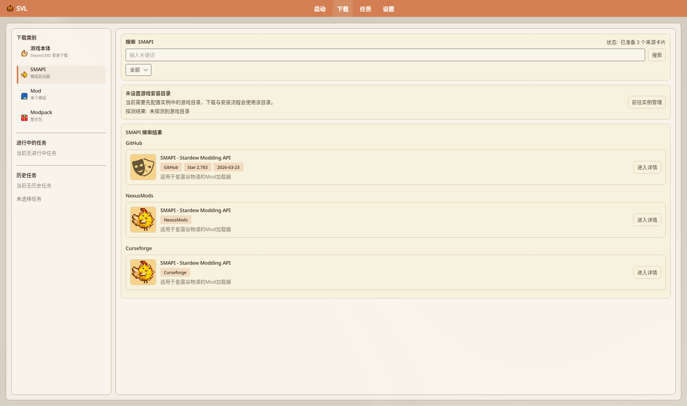

# 下载管理器（任务）

Avalonia 主入口是导航 **「任务」**（`Nav.Tasks`），列表 + 详情实时显示下载/安装进度。旧「下载管理器」窗口现为兼容壳，内嵌同一任务页。

源码：`TaskStatusPageView.axaml`、`DownloadManagerWindow.axaml`（标注「兼容旧视图入口」）、`MainWindowViewModel` 任务红点逻辑。

> 上图为导航 **「下载」**（侧栏含进行中/历史任务摘要）。完整 **「任务」** 页空状态（`TaskStatusPageView.axaml`）：标题 **任务列表**；计数硬编码 **进行中:** / **历史已完成:**（`notes.txt` OCR 偶见「运行中」，以 axaml「进行中」为准）；**清空已完成**（空时禁用）；正文「当前没有任务」+「去下载页发起任务后，这里会实时显示进度。」+ **前往下载**（本批未单独存 tasks 截图）。

## 目录

- [怎么打开](#怎么打开)
- [任务列表](#任务列表)
- [任务详情](#任务详情)
- [从哪里发起任务](#从哪里发起任务)
- [游戏本体（SteamCMD）](#游戏本体steamcmd)
- [相关设置](#相关设置)
- [与旧 Wiki 差异](#与旧-wiki-差异)

## 怎么打开

| 方式 | 说明 |
|------|------|
| 左侧导航 **「任务」** | 主入口 |
| 任务页空状态 **「前往下载」** | 跳到下载页 |
| 浮动任务按钮 | `DownloadFloatingButton`：设置勾选 **「启用任务浮动按钮」**（默认开）且 badge>0 且当前不在任务页时显示圆形浮钮（下载图标 + 角标）；点击打开任务队列 |

> 旧文「底部状态栏下载图标 / `Ctrl + D`」：Avalonia **未见** `Ctrl+D` KeyBinding；请用导航 **「任务」** 或 **启用任务浮动按钮**（有进行中任务且不在任务页时显示）。

## 任务列表

左栏：

- 标题 **「任务列表」**
- 计数：**进行中** / **历史已完成**
- **「清空已完成」**（有可清项时）
- 空状态提示：「去下载页发起任务后，这里会实时显示进度。」

每项可见：名称、状态、总进度条或**多线程分块**进度、速度 / 已下 / 总量 / ETA、子进度文案。左栏状态徽标（`DownloadTaskItem`）：`Pending`→「排队中」、进行中三段沿用实时 `Status`、`Completed`→「成功」、`Failed`→「失败」、`Cancelled`→「已取消」。冷启动若发现上次仍处于 Resolving/Downloading/Installing，会标 `Failed` 并写入失败原因「上次运行中断（可重试）」。

## 任务详情

右栏标题 **「任务状态详情」**。未选中时标题「未选择任务」，说明「从左侧列表点击一个任务，这里会展示完整进度、失败原因与操作入口。」选中后可见：

- **目标 Base 路径** / **实际安装目录**（有则显示）
- 失败时 **失败原因**；运行中 **当前进度**（含「进度: x%」、分块进度条、速度、已下/总量、ETA）
- 完成态卡片 **任务完成**：「可在下方操作栏点击打开目录查看安装结果。」；取消态 **任务已取消**：「任务被取消后可移除清理，或在下载页发起新任务。」
- 操作按钮（按状态启用，文案已核 axaml）：**取消任务**、**重试**、**移除**、**打开目录**、**打开报告**、**打开重试报告**、**重新打开来源页面**
- Collection/整合包类另有 **整合包 Mod 进度**（「a/b 个 Mod 已处理」）、分页 **上一页/下一页**（每页 8、`第 n/m 页`），行状态「等待中」/「处理中」/「已安装」/「失败」/「已跳过」/「待处理」，以及 **打开来源** / **选择文件并安装** / **跳过可选 Mod**
- **建议操作**（`AdviceTitle` + 条目列表）；有冲突时 **安装冲突预览**；真正覆盖前可弹 `ConflictResolutionDialog`（见 [Mod 管理](./Mod-Management#安装冲突对话框conflictresolutiondialog)）
- 日志区标题 **任务日志**：**复制** / **清空**

空列表文案：「当前没有任务」→ **「前往下载」**。

## 从哪里发起任务

| 来源 | 说明 |
|------|------|
| **下载** 页 | SMAPI / Mod / Modpack 搜索与安装；浏览器 NXM 协议回调入队 |
| Mod 管理 **批量更新** | 入队下载 |
| 拖放安装 | 可能进入安装任务流 |

无有效游戏路径时，下载主区黄条：**未设置游戏安装目录**（`Download.Path.*`）→ **前往实例管理**；探测前缀「探测结果: 」。若流程需要选目录：对话框「选择游戏路径」（说明「下载与安装需要有效的 Stardew Valley 目录。请先选择游戏目录。」；标签「游戏目录」+ **浏览**）→ 无效则状态「选择的目录无效：未检测到游戏核心文件」→「确认游戏路径」（正文「请确认此目录为 Stardew Valley 安装目录。确认后将作为下载与安装目标路径。」；按钮 **确认使用此路径**，写入 `PreferredInstancePath`）；详情见 [安装 Mods](../tutorials/Installing-Mods)。

下载页侧栏标题「下载类别」（实机）：**游戏本体**（副文案「SteamCMD 登录下载」，axaml 硬编码）、**SMAPI**（`Download.Category.SmapiSub`「模组启动器」）、**Mod**（「单个模组」）、**Modpack**（「整合包」）；并显示进行中/历史任务摘要。 切换类别状态栏：「通过 SteamCMD 登录并下载游戏本体（支持历史版本）」/「可搜索并安装 SMAPI」/「可搜索并安装 Mod」/「可导入或下载 Modpack」。列表标题「SMAPI 资源列表」/「Mod 资源列表」/「Modpack 资源列表」。外挂入队提示「SMAPI 安装任务已创建: {名}」；通用「已加入队列」。

## 游戏本体（SteamCMD）

下载侧栏第一项 **游戏本体**（副文案「SteamCMD 登录下载」）。主区标题 **「游戏本体下载（SteamCMD）」**。

页头说明原文：「线性流程：安装 SteamCMD → 登录 Steam 账号 → 选择版本下载。账号需已拥有该游戏。版本通过 SteamCMD 自动获取，也可输入自定义 Manifest ID。」

三步（`DownloadPageView.axaml`，可用 **上一步** / **下一步**）：

1. **安装 SteamCMD** — 文案：「首次使用需下载并解压 SteamCMD 命令行客户端（约 2MB），用于登录与下载游戏文件。」；按钮 **下载 SteamCMD**；显示 **SteamCMD 状态：**
2. **Steam 账号登录** — **账号**（水印「Steam 登录账号」）、**密码**（水印「Steam 密码」）、**Steam Guard 验证码（如需要）**（水印「邮箱验证码 / 手机令牌」）+ **登录**。黄条「关于 Steam Guard 登录」：手机令牌需在 Steam 手机 APP 批准或填验证码；等待超时约 180 秒可重试；**登录信息不会被存储。**
3. **选择游戏版本并下载** — 「SteamCMD 自动获取的版本」下拉；**自定义 Manifest ID（可选，优先于下拉）**（水印「从 SteamDB 查询 Manifest ID」）；**保存目录（须为空目录）**（水印「游戏文件保存位置」）+ **浏览**；可输入自定义指令（水印例 `app_update 413150`；提示「指令会以 +指令 +quit 形式执行；登录建议在登录页填写以支持 Steam Guard。」）

侧有 **SteamCMD 日志**。账号登录与下载未在本批截图中演示（`notes.txt` blockers）。

状态文案（`DownloadPageViewModel`，节选）：「SteamCMD 安装完成」/「SteamCMD 安装失败: …」；登录前「请先下载 SteamCMD」；「正在检查 SteamCMD 更新；首次运行可能需要几分钟，请稍候。」；超时「SteamCMD 更新超时（10 分钟），请检查网络后重试」；「正在登录 Steam...若开启手机令牌，请在 Steam 手机 APP 中批准登录；若为邮箱验证码，请填入验证码。等待可能耗时（SteamCMD 日志缓冲，非实时）。」；登录前「请输入 Steam 账号与密码」；「Steam 账号登录成功」/「需要 Steam Guard 验证码，请填写后重新登录」/「Steam 账号或密码错误」/「Steam 登录超时（180 秒），请重试或在手机 App 中及时确认」/「Steam 登录异常: …」；下载成功后确认「添加到游戏列表」：「游戏文件已下载完成。是否将“{路径}”添加到游戏列表作为 Base 路径？」；进行中状态「游戏文件下载完成」/失败「游戏文件下载失败: …」/「游戏文件下载异常: …」；「添加 Base 路径失败: …」；空队列「暂无下载任务，可通过搜索或链接导入添加」；「暂无可选搜索结果」；「该资源没有可用的详情来源」；「已探测到游戏目录: …」/「已配置游戏目录: …」/「未探测到游戏目录，已跳转到实例页进行配置」。

Avalonia 另有 `DownloadProgressDialog`（默认标题「下载进度」；进度条；状态默认「等待中」；**取消任务** / **关闭**），但业务调用仅见于 WPF `SVL.Desktop`——Avalonia 任务进度以 **「任务」** 页与浮钮为准，勿写「下载必弹独立进度窗」。

## 相关设置

**设置 → 下载设置**：缓存目录、代理、下载并发、检测并发、Nexus 账户、NXM 协议注册、缓存清理、**接管下载**（http/https 另存为）等。详见 [设置与配置](./Settings)。

## 与旧 Wiki 差异

| 旧表述 | 现况 |
|--------|------|
| 独立「下载管理器」主入口 | 导航 **「任务」**；`DownloadManagerWindow` 仅兼容 |
| 强调断点续传操作步骤 | 队列与分块进度在任务页展示；勿编造未核实的「右键续传」菜单 |

---

## 相关文档

- [NexusMods 集成](./NexusMods-Integration)
- [安装 Mods](../tutorials/Installing-Mods)
- [Modpack 整合包](./Modpack-Support)
