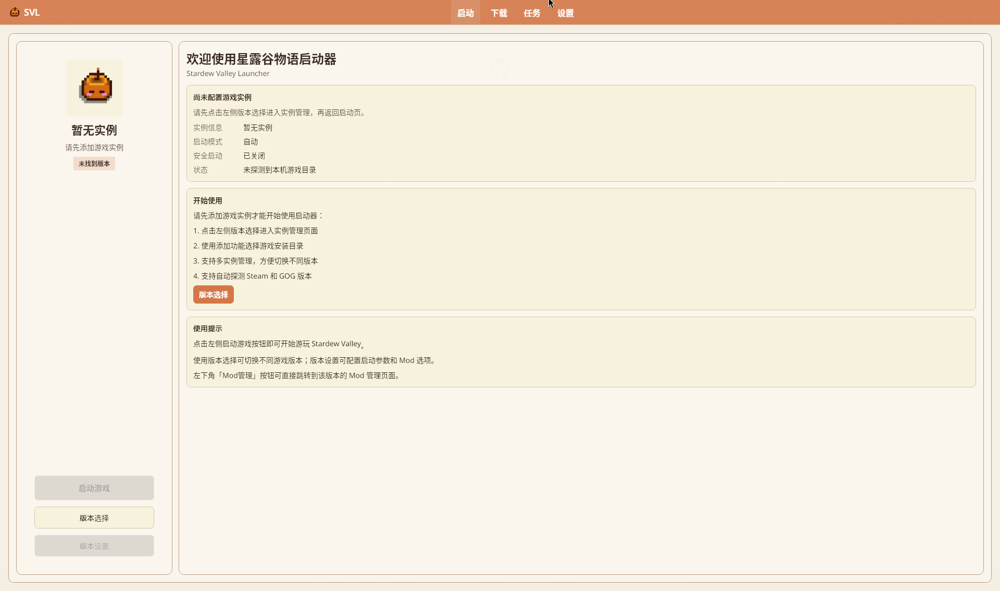
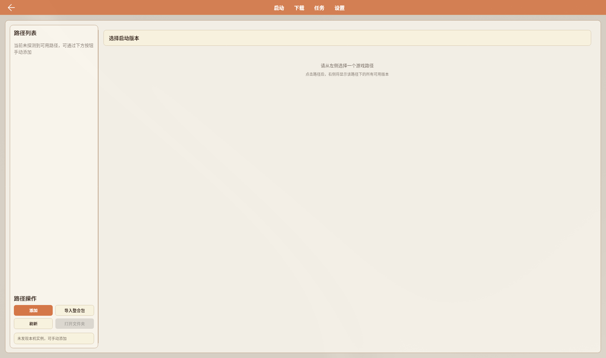

# 游戏实例管理

管理 Base 路径、Versions 隔离实例，以及版本设置各页。

主界面示意（Linux · v1.2.0.0）：

## 目录

- [实例是什么](#实例是什么)
- [进入版本选择](#进入版本选择)
- [路径与卡片](#路径与卡片)
- [创建与导入](#创建与导入)
- [版本设置](#版本设置)
- [启动相关](#启动相关)
- [隔离说明](#隔离说明)

## 实例是什么

| 类型 | 含义 |
|------|------|
| **Base** | 原始游戏安装目录 |
| **Version（隔离实例）** | `Base/versions/<名>/`，独立 Mods / 常含独立 SMAPI |

- Mods：**按实例隔离**
- 存档：**共享**系统默认目录（见 [版本隔离](./Version-Isolation)）

## 进入版本选择

启动页按钮：

| 按钮 | 作用 |
|------|------|
| **启动游戏** | 启动当前选中实例 |
| **版本选择** | 打开实例/路径页 |
| **Mod管理** | 有可用实例时显示，进版本设置的 Mod 管理 |
| **版本设置** | 打开当前实例的版本设置 |

也可在实例卡片上点齿轮（工具提示「版本设置」）或星标收藏。

## 路径与卡片

版本选择页：

- 左：**游戏路径**列表 + **路径操作**（添加 / 导入整合包 / 刷新 / 打开文件夹）
- 右：**选择启动版本** — 分组 **Base** / **Versions**

卡片上可见：名称、SMAPI/原版标签、游戏版本、SMAPI 版本、路径。

路径右键：重命名、打开文件夹、刷新信息、删除。

> 「克隆实例」等旧 Wiki 右键菜单：**待核实**（现版卡片未见对等项）。

## 创建与导入

详见 [创建游戏实例](../tutorials/Creating-Instance)。摘要：

1. **添加** Base 文件夹  
2. 下载/拖入 **SMAPI** → 命名 → 生成 Versions 实例  
3. **导入整合包** 或下载页安装整合包  

无「启用隔离」勾选；隔离为默认产物。

## 版本设置

| 侧栏 | 内容摘要 |
|------|----------|
| **概览** | 图标、名称、描述、收藏；打开文件夹；删除当前版本 / 卸载 Base SMAPI |
| **自动安装** | **安装 / 更改 SMAPI** |
| **Mod 管理** | 见 [Mod 管理](./Mod-Management) |
| **设置** | 窗口标题、启动参数、Steam 大厅 ID、Steam 启动参数覆写；**无版本隔离开关** |
| **导出** | 导出清单（默认不含 Mod 本体） |

## 启动相关

- 在版本选择中点选实例后返回启动页，再 **启动游戏**。
- 启动模式、安全启动等字段以现版启动页/设置为准（**待核实**与旧「双击卡片启动」是否仍支持）。

## 隔离说明

- **不要**再写「设置页打开实例隔离」。
- 存档**不**随 Versions 目录隔离。
- 删版本 ≠ 删存档；删前备份 Mods 与存档。

---

## 相关文档

- [版本隔离](./Version-Isolation)
- [创建游戏实例](../tutorials/Creating-Instance)
- [SMAPI 管理](./SMAPI-Management)
- [设置与配置](./Settings)
