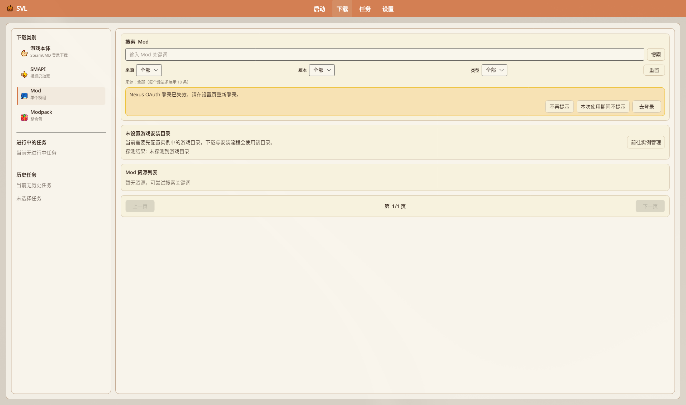

# Mod 管理

在版本设置 → **「Mod 管理」** 中管理当前实例 Mods 目录内的模组。

源码：`VersionSettingsPageView.axaml`（Mod 管理段）、`FeaturePagesViewModels` 中 Mod 相关命令。

## 目录

- [打开入口](#打开入口)
- [安装 Mod](#安装-mod)
- [工具栏](#工具栏)
- [列表与筛选](#列表与筛选)
- [启用 / 禁用 / 卸载](#启用--禁用--卸载)
- [更新与冲突](#更新与冲突)
- [备份页](#备份页)
- [待核实](#待核实)

## 打开入口

> **截图说明**：`mods.png` 实为导航 **下载 → Mod 搜索**（见 [安装 Mods](../tutorials/Installing-Mods)），**不是**版本设置里的 Mod 管理页。本批因无本地实例未拍到实例 Mod 管理；下文工具栏/筛选以 `VersionSettingsPageView.axaml` 为准。

1. **版本选择** → 实例齿轮；或启动页 **「Mod管理」** / **「版本设置」**。
2. 左侧点 **「Mod 管理」**。

Mods 实际路径：隔离实例为 `…/versions/<名>/Mods`。

## 安装 Mod

| 方式 | 说明 |
|------|------|
| **下载页** | Nexus / CurseForge 等搜索安装到当前/指定实例 |
| **拖放** | 将 zip 等拖入启动器（`InstallModFromDropAsync`） |
| **本地安装** | 工具栏「+」按钮，提示「从本地安装 Mod」 |
| **打开文件夹** | 手动解压进 Mods 后点 **刷新** |

旧文「从 ZIP 安装 / 从文件夹安装」独立大按钮：**改为**上述「+」与拖放/文件夹，勿再写已消失的菜单名。

## 工具栏

Mods 分栏可见（文案以界面为准）：

| 按钮 | 作用 |
|------|------|
| **打开文件夹** | 打开当前实例 Mods |
| **检测更新** | 扫描可更新项 |
| **批量更新** | 有可更新项时显示；入队下载 |
| **检测冲突** | 冲突检测 |
| **检测汉化** / **刷新选中汉化** | 社区汉化相关 |
| **全选** / **刷新** | 选择与重载列表 |
| **+** | 从本地安装 |

底栏批量：**启用已选** / **禁用已选** 等。

## 列表与筛选

- 主分栏：`Mods(n)` / `备份(n)`
- 筛选：`全部(n)` / `启用(n)` / `禁用(n)` / `可更新(n)`
- **Mod搜索**：水印含 `tag:` / `author:` / `name:`；**清空**、**高级语法**
- **Tag 筛选与管理**：勾选 **文件夹式** / **前缀式** / **自定义**
- 底部分页：**上一页** / 页码 / **下一页**；显示「共 n 项」

行内可有启用、禁用、卸载等操作。

## 启用 / 禁用 / 卸载

- 底栏固定：**启用已选** / **禁用已选**（`EnableSelectedModsCommand` / `DisableSelectedModsCommand`）
- 卸载走选中项卸载命令；会改动 Mods 目录——**先备份**
- 多选依赖列表勾选 + 底栏批量；旧「Ctrl + 右键菜单批量」**未见**对等 ContextMenu，勿照搬

## 更新与冲突

1. **检测更新** → 筛「可更新」  
2. **批量更新** → 确认后入下载队列；覆盖前会尝试备份（见确认框文案）  
3. **检测冲突**（`DetectModConflictsCommand`）→ 使用社区冲突关系；完成后摘要类似「发现 n 项社区冲突…」或「目前未检测到冲突」  
4. Mod 详情页 **「贡献本地化」** → 打开 `https://svl.qzz.io/contribute.html`（可带 Unique ID 预填）  

无来源/无 FileID 的 Mod 可能无法自动更新，需手动处理。冲突数据不足时可到社区贡献页补充。

## 备份页

同一 Mod 管理内的 **备份** 分栏：打开备份文件夹、全选、刷新。  
备份标签页不支持检测更新 / 批量更新（源码有明确提示）。

## 待核实

- 依赖树可视化是否完整展示
- 拖放对「仅文件夹」与「嵌套 zip」的边界行为
- 与下载页「安装目标实例」切换的完整 UI 文案

---

## 相关文档

- [安装 Mods](../tutorials/Installing-Mods)
- [版本隔离](./Version-Isolation)
- [NexusMods 集成](./NexusMods-Integration)
- [下载管理器](./Download-Manager)
