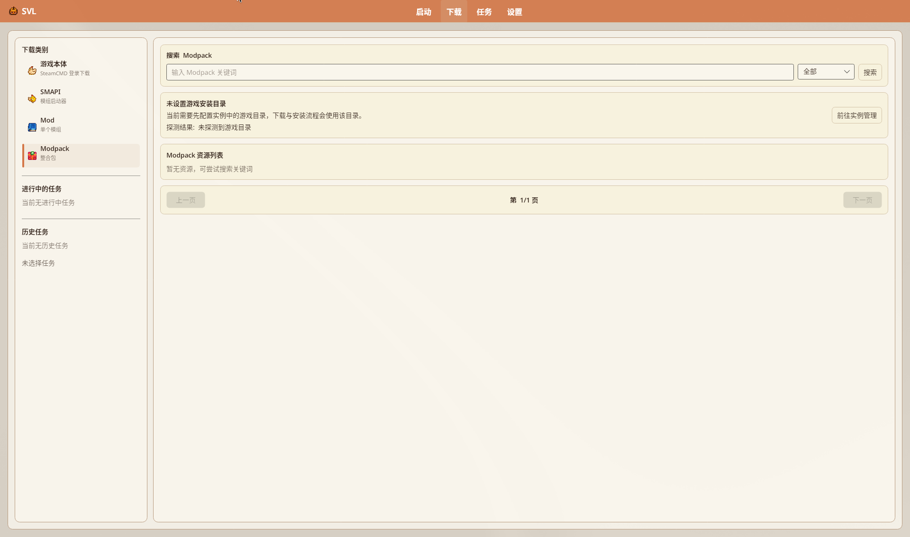

# Modpack 整合包

导入、搜索安装与**导出**整合包。导出默认按来源清单分发，**不含 Mod 本体文件**。

源码：`ModpackInstallService`、`VersionSettingsPageView` 导出段、`InstancesPageView` **「导入整合包」**、下载页 Modpack 类别。

## 目录

- [支持的格式](#支持的格式)
- [导入](#导入)
- [从下载页安装](#从下载页安装)
- [导出](#导出)
- [包内结构（SVL）](#包内结构svl)
- [注意](#注意)

## 支持的格式

| 类型 | 识别要点 |
|------|----------|
| **SVL** | 含 `modpack.json`（常配合 `sources.json`）；zip 或已解压目录 |
| **CurseForge** | `manifest.json`；`.zip` / `.cfmodpack`（仍按 zip 处理） |
| **`.7z`** | 文件选择器与拖放白名单包含；解压能力随实现 |
| **Nexus Collection** | Collection 安装链路（并行度等受设置约束） |

本地文件选择器筛选：**整合包文件** = `*.zip` / `*.cfmodpack` / `*.7z`。拖放非白名单格式时弹「不支持的文件」：「支持 .zip、.cfmodpack 和 .7z 整合包格式。」（`MainWindowViewModel`）。

第三方变体若缺 `sources.json`，安装器会尝试与 `modpack.json.mods` 合并来源字段（兼容逻辑以源码为准）。

## 导入



下载页类别 **Modpack**（副文案「整合包」）：主区标题「搜索 Modpack」；水印「输入 Modpack 关键词」+ 来源下拉 + 搜索；空列表「暂无资源，可尝试搜索关键词」。版本选择 **导入整合包** 会跳到此搜索页（`OpenModpackSearchPage`）。`Download.Modpack.Description` / URL 导入相关键存在于 Localization 与 VM，但 `DownloadPageView.axaml` **未见** URL 粘贴卡片绑定（与 NXM 粘贴框同类缺口）——勿写「下载页可直接粘贴 Modpack URL」。本地文件导入走拖放 / 选择器（见下）。


1. **版本选择** → 路径操作 **「导入整合包」**（跳到下载页 Modpack 搜索，非文件选择器）。  
2. 或把整合包 zip **拖入**启动器（白名单见上；非白名单对话框标题「不支持的文件」，正文「支持 .zip、.cfmodpack 和 .7z 整合包格式。」）。  
3. 拖放/导入对话框（`ModpackDropDialog`，默认标题「导入 Modpack」）：先显示「正在检测整合包类型...」；失败则「检测失败」+ 错误信息 + **关闭**。成功后可见名称/类型/版本、**作者**、Mod 数量、描述；**安装到路径**（下拉来自版本选择路径列表；项显示「显示名 + 换行 + 完整路径」以免同名 Base 混淆；默认优先选当前实例所属 Base）；**版本实例名称**（水印「输入版本实例名称（用于版本隔离目录）」）；**取消** / **导入**。  
4. 进度在 **「任务」** 查看。失败时 `MainWindowViewModel` 可弹 `ModpackFailureDialog`：标题「整合包安装结果 - {任务名}」（默认控件标题「Modpack 安装失败」）；正文为失败原因；「日志:」+ 路径；按钮 **查看日志** / **重试**（`CanRetry` 时）/ **关闭**。

装完后通常得到 `versions/<名>/` 隔离实例（Mods 独立；存档仍共享，见 [版本隔离](./Version-Isolation)）。

## 从下载页安装

导航 **「下载」** → 类别 **Modpack** → **搜索 Modpack** 列表安装。  
Localization 另有 `Download.Modpack.Title/Description/UrlWatermark/Import/OpenSearch` 等键，且 VM 有 `QueueModpackUrlDownload`，但 **axaml 未挂载**对应输入框/按钮；实机勿按旧文寻找「导入 Modpack URL」卡片。文件导入：拖放或文件选择器（`*.zip` / `*.cfmodpack` / `*.7z`）。

## 导出

**版本设置 →「导出」**：

分区标题「导出内容」。字段与勾选：

| 字段 / 勾选 | 说明 |
|-------------|------|
| 整合包名称 / 版本 / 作者 | 写入清单 |
| **导出 Mod 清单**（`IncludeMods`，默认开） | 写入 `modpack.json` + `sources.json` 条目；**不是**打包 dll/资源本体；列表可 **全选/反选**，旁注「来源优先导出清单，无来源条目仅保留安装提示」 |
| **导出 Mod 配置文件（config/*.json、根目录自定义 JSON）**（`IncludeModSettings`，默认开） | 勾选文案已核 axaml；写入 `settings/Mods/...` 等 |
| **导出当前 SVL 启动器文件**（默认关） | 外层带启动器的增强包格式 |
| **保存配置** / **读取配置** | 表单配置（`.svlexport` / `.json`），与正式导出分开。保存：文件夹选择器「选择导出配置保存目录」→ `{名称}_export_config.svlexport`；状态「导出配置已保存: {文件名}」/「保存配置失败: …」。读取：文件选择器「读取导出配置」（`*.svlexport`/`*.json`，兼容旧 WPF UTF-16 BOM）；「导出配置已加载」/「配置文件格式无效」/「读取配置失败: …」 |
| **导出当前整合包** | 系统另存为「另存为整合包」→ 默认 `{名称}.zip`（类型「ZIP 整合包」）；无扩展名时强制 `.zip`。无 Mod「当前实例没有可导出的 Mod」；准备「正在准备导出...」；FileID 补全「已补全 n 个…」或「有 n 个 Nexus/CurseForge Mod 缺少 FileID，将在导入时按兼容流程处理」；完成「导出完成：{文件名}」或同句加缺少 FileID 提示；失败「导出失败: …」；摘要「最近导出: {路径}」/「尚未导出」；进度「导出进度 n%」 |
| **打开导出目录** | `OpenExportFolderCommand` |

策略全文：「导出策略：为遵循来源平台分发规则，导出包不直接包含 Mod 本体，仅导出清单及可选配置。」`sources` 里 `Bundled = false`。导入端按来源再下载。

无完整来源凭证的条目会标需手动安装 / 导入时兼容处理。

## 包内结构（SVL）

典型可回导包：

```text
modpack.json          # 名称、版本、SMAPI 提示、mods 列表
sources.json          # 平台 / projectId / fileId 等
export-manifest.json  # 导出审计信息（安装以 modpack+sources 为准）
settings/Mods/...     # 可选：Mod 配置
icon.png              # 可选：实例图标
```

带启动器的包：外层启动器 + 内层 `modpack.zip`（与普通平铺包不同）。

## 注意

- 分享清单包需接收方能访问 Nexus/CF 等来源，并遵守平台条款。  
- 导出前宜登录 Nexus，便于补全缺失 FileID。  
- 删改 Base / 实例前先备份。

---

## 相关文档

- [创建游戏实例](../tutorials/Creating-Instance)
- [版本隔离](./Version-Isolation)
- [下载管理器](./Download-Manager)
