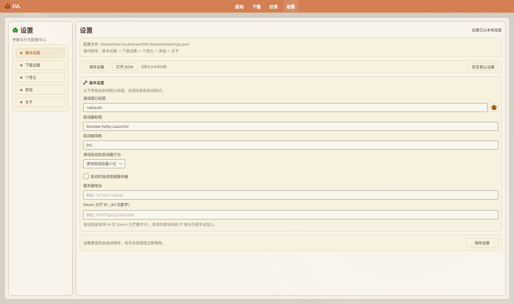
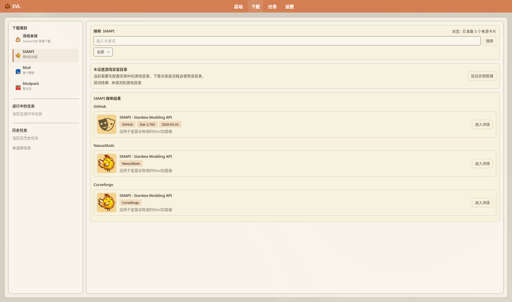
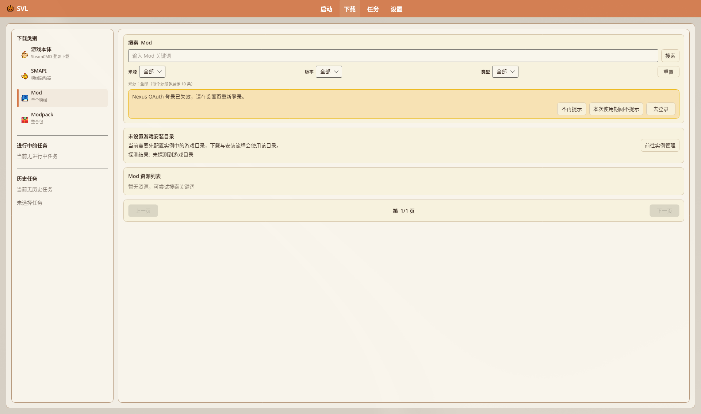

# NexusMods 集成

在启动器内登录 Nexus、搜索/下载 Mod，并用 **NXM** 协议承接浏览器回调。

源码：`SettingsPageView.axaml`（下载设置）、`DownloadPageView` / Mod 搜索相关页、`OpenNexusLoginCommand`。

> Nexus 登录在同页左侧切到 **「下载设置」** 卡片（本批截图停在基本设置）。

## 目录

- [登录](#登录)
- [下载页登录失效条幅](#下载页登录失效条幅)
- [登录后能做什么](#登录后能做什么)
- [搜索与下载](#搜索与下载)
- [NXM 协议](#nxm-协议)
- [API 额度](#api-额度)
- [Collection](#collection)
- [免费 vs Premium（已核源码语义）](#免费-vs-premium已核源码语义)

## 登录

入口在 **「设置」→「下载设置」→「NexusMods 账户」**（不是旧文独立顶栏「设置 → NexusMods」）。

1. 打开上述卡片。  
2. 点登录按钮：正常为 **登录 Nexus**；凭证失效但有本地档案时为 **重新登录 Nexus**（`NexusLoginActionText`）→ 弹出 `NexusLoginDialog`。  
3. 在对话框内完成 OAuth（见下）。  
4. 回到设置卡片；可点 **「验证状态」** / **「刷新 Token」**（状态「Nexus 状态验证成功」/「Nexus 验证失败」/「Nexus OAuth 验证失败」；「OAuth Token 刷新成功」/「当前没有可用的 OAuth Refresh Token」/「请重新登录 Nexus」；登录后「Nexus 登录状态已更新并保存」）。  
5. 退出用卡片 **「退出登录」**（对话框内登录态为 **登出**；设置状态「已退出 Nexus」）。

未登录时：非 Nexus 资源仍可用；NXM / 受限 Nexus 下载会受限。设置卡片原文：「登录后可直接处理 NXM 链接与受限资源」；未登录引导：「未登录时仅可使用非 Nexus 资源；登录后可直接导入 NXM 并执行受限下载。」

### 登录对话框（`NexusLoginDialog`）

窗口标题「Nexus 登录」；顶栏「Nexus Mods 登录」。主文案「NEXUS MODS」+「安全登录 SVL 以访问 Nexus Mods 资源」。

| 状态 / 控件 | 文案 |
|-------------|------|
| 未登录卡 | 「未登录」；「请点击下方按钮登录您的 Nexus Mods 账户」 |
| 主按钮 | 默认 **登录 Nexus Mods**（`LoginButtonText`） |
| 初始 OAuth 提示 | 「点击“登录 Nexus Mods”后，将在浏览器完成授权并自动返回此窗口」 |
| 进行中 | 「正在启动本地回调监听并打开授权页面...」→「正在等待浏览器授权；若回调页面无法打开，可在下方粘贴回调地址。」 |
| **重试登录并打开浏览器** | 授权中途可见 |
| 手动回调 Expander | 「回调页面打不开？手动完成登录」；说明「请粘贴当前授权页面跳转后的完整地址。授权码仅用于本次登录，请勿分享。」；水印「粘贴浏览器地址栏中的回调地址」；**提交回调地址** |
| 已登录卡 | 「已登录」+ 用户名 / 会员类型；按钮 **登出** |
| 底部能力说明 | 「登录后您可以：」• 下载 Nexus Mods 上的 MOD • 查看 MOD 详情和更新 • 同步您的 Nexus Mods 账户 |
| 底栏 | **关闭** |

常见状态：「授权地址已复制，可粘贴到浏览器打开」「OAuth 自动登录成功：{用户}」「等待自动回调超时；可在下方粘贴本次回调地址，或重新开始登录。」等（`NexusLoginDialogViewModel`）。本批截图未演示登录流程（`notes.txt`）。

### 下载页登录失效条幅

Mod 搜索等处可能出现：「Nexus OAuth 登录已失效，请在设置页重新登录。」

| 按钮 | 行为 | ToolTip（axaml） |
|------|------|------------------|
| **不再提示** | 写入 `settings.json` 的 `SuppressNexusAuthNotification=true` 并隐藏 | 「持久化隐藏，直到在设置页重新开启」 |
| **本次使用期间不提示** | 仅本会话抑制（`_suppressNexusAuthNotificationThisSession`） | 「仅在本次运行期间隐藏」 |
| **去登录** | 跳转设置页 Nexus 登录区（`GoToNexusLogin`） | 「跳转到设置页 Nexus 登录区」 |

设置页勾选 **「Nexus 登录失效提醒」** 对应 `EnableNexusAuthNotification`（与 `SuppressNexusAuthNotification` 取反保存；ToolTip：「关闭后下载页将不再提示 Nexus 登录失效」）。

## 登录后能做什么

| 能力 | 说明 |
|------|------|
| 头像 / 用户名 / 会员类型 | 登录态展示 |
| 每日 / 每小时请求 | API 统计 |
| NXM 协议回调与受限下载 | 需有效登录（下载页无独立粘贴导入控件） |
| 导出补全 FileID | 导出整合包时可尝试补 Nexus/CF FileID |

## 搜索与下载

1. 导航 **「下载」**。  
2. 类别选 **Mod**（或进 Mod 搜索页）。  
3. 搜索 → 详情 → 选文件 → 安装到目标实例。  
4. 进度看导航 **「任务」**。

浏览器唤起的 `nxm://` 由协议注册回传（见下「NXM 协议」）；下载页**无**粘贴框。

## NXM 协议

设置 → 下载设置 → **「NXM 协议」** 卡片（副文案「处理浏览器中的 nxm:// 协议跳转」；说明键「用于浏览器中的 nxm:// 链接快速回传到启动器下载页。」）：

| 项 | 作用 |
|----|------|
| **启动时尝试注册 NXM 协议** | 开机/启动时注册 |
| **重新注册 NXM 协议** | 手动再注册 |
| 说明 | 浏览器 `nxm://` 回传到启动器下载流 |

浏览器 `nxm://` 回调由协议注册承接（`Program` 解析命令行）。`LocalizationService` / `DownloadPageViewModel` 仍有「NXM 链接导入」「导入 NXM」等文案键，但现行 `DownloadPageView.axaml` **未见**粘贴导入控件；请用协议回调或设置页 NXM 注册，勿写「下载页必有粘贴框」。

平台实现（`SVL.Core.Platform` / `NxmProtocolRegistrationService`）：

- **Linux**（`LinuxNxmProtocolRegistration`）：写入 `XDG_DATA_HOME/applications/svl-avalonia-nxm.desktop`（缺省 `~/.local/share/…`；`NoDisplay=true`；`MimeType=x-scheme-handler/nxm;`；`Exec="<可执行路径>" %u`；Name=`Stardew Valley Launcher`）。同时 upsert `XDG_CONFIG_HOME/mimeapps.list` 的 `[Default Applications]` 项 `x-scheme-handler/nxm=svl-avalonia-nxm.desktop;`，并按 `XDG_CURRENT_DESKTOP`（冒号分隔，如 `gnome`）写对应 `{de}-mimeapps.list`。状态文案：「NXM 协议已注册」/「NXM 协议未注册」；失败常见「未找到启动器可执行文件，无法注册 NXM 协议」「NXM 协议注册失败: …」「读取 NXM 协议状态失败: …」。
- **Windows**：HKCU `nxm` URL Protocol + `shell\open\command` = `"<exe>" "%1"`；成功固定「NXM 协议注册成功」（与 Linux/macOS 状态轮询文案略有不同）。
- **macOS**：要求 `.app` 含 `Contents/Info.plist` 且已声明 `nxm` URL scheme；缺 plist：「SVL .app 缺少 Contents/Info.plist，无法注册 NXM 协议。」；未声明 scheme：「SVL .app 尚未在 Info.plist 声明 nxm URL scheme；请重新打包应用后再注册。」；Launch Services 失败：「NXM 协议注册失败（Launch Services 错误码 n）」。
- 设置页开关关闭时状态也可显示「未启用自动注册」；打开则为「已启用自动注册」（加载时），随后被 `GetStatus` 覆盖为已注册/未注册。
- 便携解压 / Flatpak 等非标准布局：**可能**写不到上述路径，请用设置内「重新注册」看结果文案。不支持的平台：「当前平台不支持自动注册 NXM 协议」。

## API 额度

登录后卡片显示每日 / 每小时请求计数。额度用尽会导致搜索或下载失败；可稍后再试或减少并发（下载设置里的检测/下载并发）。

## Collection

Nexus Collection 可通过整合包安装链路处理（见 [Modpack 整合包](./Modpack-Support)）。任务页选中 Collection/整合包任务时显示 **整合包 Mod 进度**（文案形如「a/b 个 Mod 已处理」；分页每页 **8** 条，页码「第 n/m 页」；行状态「等待中」/「处理中」/「已安装」/「失败」/「已跳过」/「待处理」；需求「可选」/「必需」）。行操作：**打开来源** / **选择文件并安装**（失败/跳过/待处理且需手动时）/ **跳过可选 Mod**（仅可选且「待处理」）。建议操作可提示手动来源勿把网页当压缩包、用「选择文件并安装」补装。完整「一键订阅 Collection」入口文案以现版下载/导入为准，勿照搬旧 WPF 菜单名。 任务态另见：「准备 Collection 清单」/「正在准备 Collection 清单: {名}」/「命中 Collection 缓存，准备安装」/「准备下载 Collection 包（n 个镜像）」。`CollectionInstallService` 进度 StepText 节选：「复用已缓存 Collection，跳过浏览器和下载」→「下载 Collection 数据」→「Collection 下载完成」/「Collection 文件就绪」→「解析 collection.json」→「collection.json 解析完成: n 个 Mod」→「安装 SMAPI」→「SMAPI 就绪」→「下载安装 Mod」（可含「阶段 k: 跳过可选 Mod / 复用已安装 Mod / 下载安装 Mod / 补丁应用失败」）→「应用 bundled 文件」→「bundled 文件应用完成」→「保存实例配置」。失败/取消示例：「Collection slug 不能为空」「未检测到游戏目录，无法安装 Collection」「Nexus 未登录，无法下载 Collection」「无法获取经过校验的 SMAPI 安装包，已停止 Collection 安装」「Collection 安装已取消」。

## 免费 vs Premium（已核源码语义）

- 登录态展示会员类型：`Premium` / `Free`（`NexusAuthService` 读 `is_premium`）。
- **非 Premium**：部分 NXM / 自动直链会走 **浏览器下载回退**（`BrowserDownloadFallbackService`）。等待文案示例：「请在浏览器中点击 Manual Download，启动器将自动接管...」/「…接管文件回调...」。可能弹出 `BrowserDownloadGuideDialog`（默认标题「浏览器下载指引」；默认说明「该资源需要在浏览器完成授权或手动下载。请打开链接并完成下载后返回。」；按钮 **复制链接** / **在浏览器打开**）。文件页需点 **Slow Download** / Manual Download 后回传。
- **Premium**：更易走直接 API/NXM 自动流（仍受 Nexus 配额与登录态约束）。

Flatpak / 纯便携包的 NXM 注册仍依赖上述桌面入口是否写得到，失败时以设置页状态文案为准。

---

## 相关文档

- [设置与配置](./Settings)
- [安装 Mods](../tutorials/Installing-Mods)
- [下载管理器](./Download-Manager)
