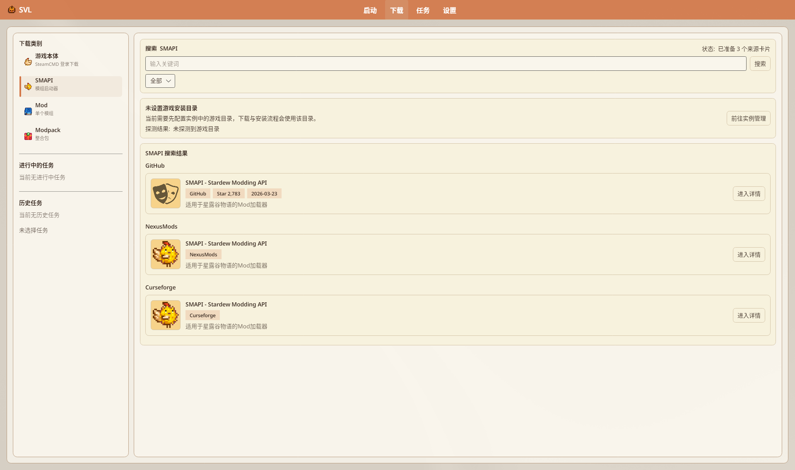
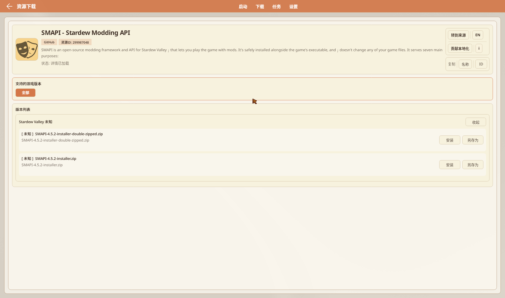

# SMAPI 管理

SMAPI（Stardew Modding API）是星露谷主流 Mod 加载器。SVL 负责下载、装到 Base 或 **versions** 隔离目录，并支持更换版本。

## 目录

- [为什么需要 SMAPI](#为什么需要-smapi)
- [安装入口](#安装入口)
- [安装来源](#安装来源)
- [Base 与隔离实例](#base-与隔离实例)
- [更换 / 更新](#更换--更新)
- [卸载](#卸载)
- [故障排除](#故障排除)

## 为什么需要 SMAPI

绝大多数 Mod 依赖 SMAPI。无 SMAPI 的 Base 在概览会提示前往 **自动安装** 页安装。

## 安装入口

| 入口 | 路径 |
|------|------|
| 下载页 | **下载** → SMAPI 详情 → **安装** → 选 Base → 起实例名 |
| 拖放 | 将 SMAPI 官方 zip 拖入窗口 |
| 版本设置 | **自动安装**（侧栏文案）→ 卡片 **「安装选项」** → **「安装 / 更改 SMAPI」**；进度文案「正在安装 SMAPI...」 |

创建实例完整步骤见 [创建游戏实例](../tutorials/Creating-Instance)。

## 安装来源

详情页标题 **资源下载**（实机 GitHub 卡示例，资源 ID 可见）：**转到来源**、语言切换（如 EN）、**贡献本地化**、复制名称/ID、**支持的游戏版本** 筛选、**版本列表**（可「收起」）。示例资源行：`SMAPI-4.5.2-installer-double-zipped.zip`、`SMAPI-4.5.2-installer.zip`，每行 **安装** / **另存为**。未配游戏目录时下载页另有黄条：**未设置游戏安装目录** → **前往实例管理**。

| 来源 | 说明 |
|------|------|
| **GitHub** | 选择器默认常见源；`settings.json` 的 `DefaultSmapiSource` 默认 GitHub，**设置页无控件** |
| **CurseForge** | SMAPI 版本选择器可选；失败可回退 GitHub |
| **NexusMods** | 需登录；非 Premium 可能等待浏览器慢速下载 + NXM 回传 |
| **本地 zip** | 拖放或本地安装流程 |

## Base 与隔离实例

| 场景 | 行为（源码语义） |
|------|------------------|
| 目标为 **Base** | 倾向于 **新建** `versions/<名>` 隔离实例 |
| 目标已是隔离目录 | 倾向于 **更新当前实例** 运行时，并尽量保留用户 Mods |
| **Base 不可隔离开关化** | 1.1.8.2 起无 UI 开关；Base 默认不当作可切换「隔离模式」 |

## 更换 / 更新

1. 打开对应实例 **版本设置 → 自动安装**  
2. **安装 / 更改 SMAPI**  
3. 选目标版本并确认  
4. 看任务/页内进度（如「正在安装 SMAPI...」）

装完后卡片应显示 SMAPI 标签与版本号；图标可能随运行时刷新。

## 卸载

- **隔离实例**：可用概览 **删除当前版本**（整实例目录，含该处 SMAPI 与 Mods）  
- **Base 上的 SMAPI**：概览在可删版本条件不满足且已装 SMAPI 时，显示 **卸载 Base SMAPI** 类按钮（`CanUninstallBaseSmapi`）

具体按钮是否可见以当前实例类型为准。

## 故障排除

| 现象 | 建议 |
|------|------|
| 校验失败 | 确认目录是完整游戏 Base；现版用「核心文件」检测，不写死单一 exe 名 |
| 下载失败 | 换源、开代理、查 Nexus/CF 登录 |
| 装完进游戏无 Mod | 确认启动的是 **SMAPI 实例** 而非纯原版；查 Mods 是否在对应 `versions/.../Mods` |
| 链接/权限错误 | Linux/macOS 检查文件系统对 symlink/junction 的支持 |

---

## 相关文档

- [创建游戏实例](../tutorials/Creating-Instance)
- [版本隔离](./Version-Isolation)
- [Mod 管理](./Mod-Management)
