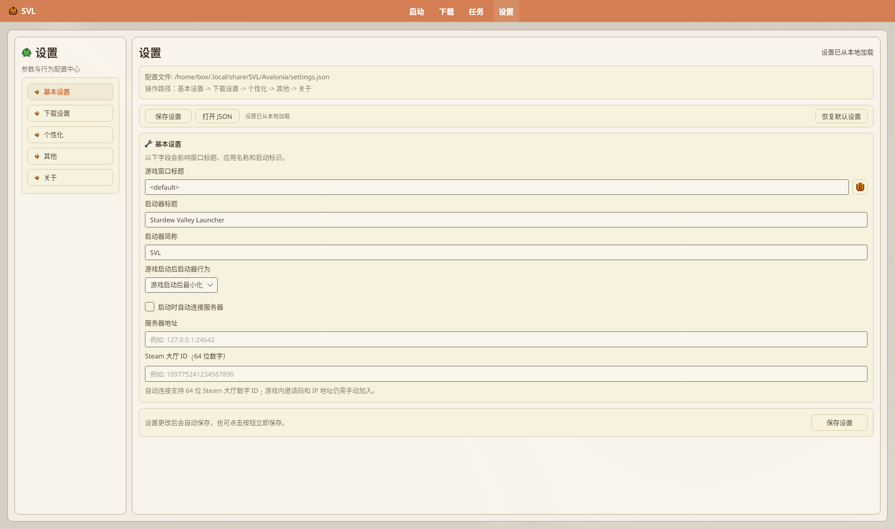
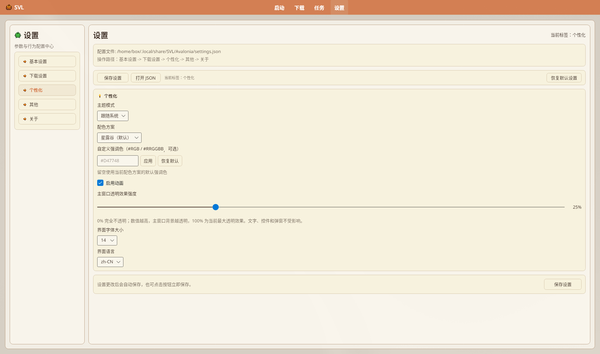

# 设置与配置

Avalonia 版设置页按左侧选项卡组织。改完多数会自动保存；也可点 **「保存设置」** / **「打开 JSON」** / **「恢复默认设置」**。

路径与字段以源码为准：`SVL.Avalonia/Views/SettingsPageView.axaml`、`Models/AppUserSettings.cs`、`Services/AppUserSettingsStore.cs`。

## 目录

- [打开设置](#打开设置)
- [选项卡一览](#选项卡一览)
- [基本设置](#基本设置)
- [下载设置](#下载设置)
- [个性化](#个性化)
- [其他](#其他)
- [关于](#关于)
- [匿名活跃统计](#匿名活跃统计)
- [配置文件](#配置文件)
- [与旧版差异](#与旧版差异)

## 打开设置

侧栏小标题「参数与行为配置中心」。选项卡：**基本设置** / **下载设置** / **个性化** / **其他** / **关于**。顶栏显示 `settings.json` 路径（Linux 例 `/home/…/.local/share/SVL/Avalonia/settings.json`）；按钮 **保存设置** / **打开 JSON** / **恢复默认设置**。

**恢复默认设置** 确认标题「恢复默认设置」：正文「将恢复界面、下载、主题和启动器偏好设置，并退出 Nexus 登录。\n\n现有游戏实例、实例路径和收藏列表不会被删除。是否继续？」；完成后状态「设置已恢复默认值（实例数据未改变）」。实例路径/名称/收藏保留；Nexus 凭据会清空（与注释中的旧 WPF 行为一致）。

1. 左侧导航点 **「设置」**（本地化键 `Nav.Settings`）。
2. 页顶会显示当前 `settings.json` 路径。

> 快捷键 `Ctrl + ,`：Avalonia 版 **未见** 等价 KeyGesture 绑定；请用左侧导航 **「设置」**。

## 选项卡一览

| 选项卡 | 本地化键 | 主要内容 |
|--------|----------|----------|
| **基本设置** | `Settings.Tab.Basic` | 窗口标题、启动器标题/简称、启动后行为、联机相关 |
| **下载设置** | `Settings.Tab.Download` | 缓存/代理、并发、Nexus、NXM、缓存清理、检测并发 |
| **个性化** | `Settings.Tab.Personalization` | 主题、强调色、动画、透明度、字号、语言 |
| **其他** | `Settings.Tab.Other` | 通知、调试、托盘 |
| **关于** | `Settings.Tab.About` | 作者、版本、更新通道 |

## 基本设置

| 界面文案 | 说明 |
|----------|------|
| **游戏窗口标题** | 可含占位符；旁「?」→ 对话框标题「窗口标题占位符帮助」：`<name>` 实例名 / `<ver>` 游戏版本 / `<smver>` SMAPI 版本 / `<modscount>` 已加载 Mod 数；留空或 `<default>` 恢复默认（启动时替换）；实机默认 `<default>` |
| **启动器标题** | 窗口标题栏；实机默认 `Stardew Valley Launcher`；状态「启动器标题已修改（已自动保存）」 |
| **启动器简称** | 应用简称；实机默认 `SVL`；状态「启动器简称已修改（已自动保存）」 |
| **游戏启动后启动器行为** | 下拉五项原文（`LauncherVisibility` 0–4，默认索引 3）：「游戏启动后立即关闭」「游戏启动后隐藏，游戏退出后自动关闭」「游戏启动后隐藏，游戏退出后重新打开」「游戏启动后最小化」「游戏启动后仍保持不变」；状态「游戏启动后行为切换为：{项}（已自动保存）」 |
| **启动时自动连接服务器** | 勾选框 |
| **服务器地址** | 例 `127.0.0.1:24642` |
| **Steam 大厅 ID（64 位数字）** | 水印例 `109775241234567890`；提示「自动连接支持 64 位 Steam 大厅数字 ID；游戏内邀请码和 IP 地址仍需手动加入。」（`SettingsPageView.axaml`；版本设置页另有相近文案） |

实例级启动选项另见版本设置 → **「设置」**，写入 `instance-launch-settings.json`。

## 下载设置

| 界面文案 | 说明 |
|----------|------|
| **启用下载缓存** | 复用已下文件；状态「已启用/已禁用下载缓存（已自动保存）」 |
| **启用下载代理** | 地址水印「例如: http://127.0.0.1:7890」；提示「Clash 等本地代理通常无需填写用户名/密码。」；可选 **代理用户名** / **代理密码** |
| **启用任务浮动按钮** | 默认开；有进行中任务且当前不在任务页时显示圆形浮钮（仅图标 + 角标数字，无文字标题；点击打开任务队列） |
| **Collection 冲突策略** | `CollectionInstallConflictStrategy` 下拉原文：「覆盖」「跳过」「仅备份」（默认「覆盖」）；状态「Collection 冲突策略切换为：{项}（已自动保存）」 |
| **下载任务并发上限（含 Collection/整合包）** | `CollectionDownloadParallelism`（下拉 1–10，默认 **3**） |
| **下载线程数** | `DownloadSegmentThreads`（下拉 `1/2/3/4/6/8/12/16`，默认 **4**）；说明「多线程分片下载可提升大文件速度，任务进度条将按线程分块显示；失败重试支持断点续传。」；状态「下载线程数切换为：n（已自动保存）」。另有 Collection 下载并发状态「Collection 下载并发切换为：n（已自动保存）」（钳制 1–10） |
| **接管下载** | 说明「粘贴 http/https 下载地址，另存为本地文件。适用于非 Nexus/CurseForge 来源的 Mod 或资源。」；水印 `https://example.com/mod.zip`；按钮 **另存为并下载**（另存对话框标题「接管下载 - 另存为」）。无效 URL 状态「请输入有效的 http/https 下载地址」；入队后「已添加接管下载任务：{文件名}」（任务名「接管下载: …」，经统一队列调度） |
| **NexusMods 账户** | 登录态显示头像/用户名/会员类型；**API 统计**（每日/每小时请求）；「状态:」「账号:」行；未登录引导见 [NexusMods 集成](./NexusMods-Integration)；按钮：**登录 Nexus** / **重新登录 Nexus**（`NexusLoginActionText`）、**验证状态**、**刷新 Token**、**退出登录**；状态「Nexus 登录状态已更新并保存」；验证「请先登录 Nexus」/「Nexus 验证失败」/「Nexus 状态验证成功」/「Nexus OAuth 验证失败」；刷新「当前没有可用的 OAuth Refresh Token」/「OAuth Token 刷新成功」/「请重新登录 Nexus」；「已退出 Nexus」；自动「检测到过期 Token，已自动刷新」/「Nexus OAuth Token 已过期且无法自动刷新，请重新登录」/「Nexus API Key 验证失败，请重新登录」；失效提醒开关「已启用/已关闭 Nexus 登录失效提醒（已自动保存）」 |
| **Nexus 登录失效提醒** | `EnableNexusAuthNotification`；ToolTip「关闭后下载页将不再提示 Nexus 登录失效」 |
| **NXM 协议** | **启动时尝试注册 NXM 协议**（勾选状态「已启用/已禁用 NXM 启动自动注册（已自动保存）」）；按钮 **重新注册 NXM 协议**；状态「NXM 协议已注册」/「未注册」等（详见 [NexusMods 集成](./NexusMods-Integration#nxm-协议)；无首启强制弹窗） |
| **社区汉化数据源** | 下拉 `Gitee` / `GitHub`；提示「GitHub 为国际源，Gitee 为国内加速源。首选源失败时自动尝试备用源。」 |
| **缓存管理** | 分类清理、保留时长、打开缓存目录 |
| **检测并发** | 原文 **Mod 更新检测线程数** / **Mod 汉化检测线程数**（`MaxConcurrentModUpdateChecks` / `MaxConcurrentModLocalizationChecks`，默认各 **4**，钳制 1–16）；状态「Mod 更新检测并发切换为：n（已自动保存）」/「Mod 汉化检测并发切换为：n（已自动保存）」 |
| **默认 SMAPI / Mod 源** | 仅 `settings.json` 字段 `DefaultSmapiSource`（默认 GitHub）、`DefaultModSource`（默认 NexusMods）；**设置页 UI 无对应控件**（迁移/目录逻辑会读） |

### 缓存管理（下载设置内）

界面文案（`SettingsPageView.axaml`）：

| 分类 | 清理按钮效果（状态栏） |
|------|------------------------|
| **社区汉化** | 「社区汉化缓存已清理」 |
| **SMAPI 下载** | 「SMAPI 下载缓存已清理」 |
| **下载安装** | 「下载安装临时文件已清理」 |
| **图片/图标** | 「图片/图标缓存已清理」 |
| **下载文件缓存** | 「下载文件缓存已清理」 |
| **游戏本体下载缓存** | 「游戏本体下载缓存已清理」 |
| **Nexus 下载缓存** | 「Nexus 下载缓存已清理」 |

另有：**总缓存大小** / **缓存文件数**、**搜索/汉化缓存保留时长（分钟）**、**下载归档缓存保留时长（分钟）**（提示「至少 1 小时」）、**刷新统计** / **清理过期**（成功「已清理过期缓存 n 个文件（保留 m 分钟）」/失败「清理过期缓存失败: …」）/ **打开缓存目录**（「已打开缓存目录: …」/「打开缓存目录失败」）/ **全部清理**（「所有缓存已清理」）；时长保存「缓存保留时长已设为 n 分钟（已自动保存）」/「下载归档缓存保留时长已设为 …（已自动保存）」；「社区汉化源切换为：{项}（已自动保存）」。  
**社区汉化数据源** 下拉为 `Gitee` / `GitHub`（提示：GitHub 国际源，Gitee 国内加速；首选失败自动备用）。

## 个性化

| 界面文案 | 说明 |
|----------|------|
| **主题模式** | 浅色 / 深色 / 跟随系统；状态「主题模式切换为：{项}（已自动保存）」 |
| **配色方案** | 星露谷（默认）、天空蓝、森林绿、薰衣紫、海洋青、樱花粉、夕阳橙；「配色方案切换为：{项}（已自动保存）」 |
| **自定义强调色** | `#RGB` / `#RRGGBB`，可「应用」「恢复默认」 |
| **启用动画** | 开/关；状态「已启用/已禁用动画（已自动保存）」 |
| **主窗口透明效果强度** | 0–100 滑条（默认 25%）；状态「主窗口透明效果强度：{百分比}（已自动保存）」 |
| **界面字体大小** | `12 / 13 / 14 / 15 / 16 / 18 / 20`（默认 14）；状态「界面字体大小切换为：n（已自动保存）」 |
| **界面语言** | `zh-CN` / `en-US`；状态「界面语言切换为：{项}（已自动保存）」；保存时若应用语言异常「设置已保存，但应用语言失败：…」 |

## 其他

副标题「运行时行为与调试选项」（`Settings.Other.Subtitle`）。

| 界面文案（本地化键） | 说明 |
|----------|------|
| **显示通知** | `Settings.Other.ShowNotifications`；状态「已启用/已禁用通知（已自动保存）」 |
| **来源为全部时提示类型筛选不可用** | `Settings.Other.TypeFilterNotice` / `ShowModTypeFilterDisabledNotice`；状态「已启用/已禁用类型筛选不可用提示（已自动保存）」 |
| **启用调试模式** | 下方硬编码提示：「调试模式在重启启动器后生效。」；状态「已启用/已禁用调试模式，重启后生效（正在自动保存）」 |
| **启动时最小化到托盘** | `MinimizeToTrayOnStartup`；「已启用/已禁用启动时最小化到托盘（已自动保存）」 |
| **关闭窗口时最小化到托盘** | `MinimizeToTrayOnClose`；「已启用/已禁用关闭时最小化到托盘（已自动保存）」 |

`Settings.Other.LogLevel`（「日志级别」）与 `settings.json` 的 `LogLevel`（默认 `Info`）仍存在，但 `SettingsPageView.axaml` **其他**页**未见**对应下拉——勿写「设置里可改日志级别」。

### 调试控制台（`DebugMode`）

勾选 **启用调试模式** 并**重启**后，启动流程会自动打开 `DebugConsoleWindow`（窗口标题「SVL Debug Console」；顶栏「Debug 日志输出」；按钮 **导出** / **清空**；「级别过滤:」**DEBUG** / **INFO** / **WARN** / **ERROR**）。窗内状态：「日志已清空。」；无内容「当前没有可导出的日志。」；成功「已导出日志: {路径}」；失败「导出失败: …」。此为运行时日志窗，**不是**设置页「日志级别」下拉的替代 UI。

### 系统托盘（`TrayIconService`）

勾选上述托盘相关项且平台支持时生效：托盘 ToolTip「SVL 启动器」；菜单 **显示主窗口** / **退出**。无桌面托盘实现时注册失败会静默回退窗口模式（不阻断启动）。关闭主窗口是否进托盘由 **关闭窗口时最小化到托盘** 与 `IsAvailable` 共同决定。

## 关于

- 作者卡片标题「作者」：**盛夏de背影** / `mc_shengxia`；按钮 **赞助支持** → `https://ifdian.net/a/mcshengxia`
- 启动器信息卡标题「Stardew Valley Launcher」；字段「版本号：」→ `AppVersion`；「技术栈：」固定「**.NET 10 + Avalonia 11（跨平台）**」
- 按钮：**查看源码** → GitHub `panda-lsy/SVL-StardewValleyLauncher`；**打开官网** → `https://svl.qzz.io/`

### 更新设置（关于页卡片）

副标题文案：「自动检查和版本通道策略」。勾选与下拉（`LocalizationService` 中文键）：

| UI | 字段 / 选项 |
|----|-------------|
| **启动时自动检查更新** | `EnableAutoUpdateCheck`（默认开）；状态「已启用/已禁用自动检查更新（已自动保存）」 |
| **发现新版本时自动下载** | `AutoDownloadUpdate`（依赖上一开关）；「已启用/已禁用自动下载更新（已自动保存）」 |
| **发现新版本时显示提示** | `ShowUpdateNotification`（默认开；依赖自动检查）；「已启用/已禁用更新通知（已自动保存）」 |
| **更新源偏好** | `PreferredUpdateSource`：`GitHub (推荐)` / `Gitee (国内加速)`；「更新源偏好切换为：{项}（已自动保存）」 |
| **更新通道** | `UpdateChannel`：`稳定版` / `预览版`（预览版会查 prerelease）；「更新通道切换为：{项}（已自动保存）」 |
| 状态行 | 标签「更新状态」「最新版本」「更新源」「当前包体」；初始「尚未检查更新」；常见状态：「正在检查更新...」「已是最新版本」「发现新版本 {0}」「已忽略版本 {0}」「检查更新失败」/「检查更新失败: {异常}」；「没有适合当前平台的更新文件」；「正在后台下载启动器更新」；「启动器更新已下载，可在检查更新时安装」；「后台下载更新失败：…」；「更新已下载，安装程序已启动，启动器即将关闭。」 |
| **立即检查更新** | `CheckLauncherUpdateCommand`；另有「已打开发布页」/「打开发布页失败，请稍后重试」 |

页内提示：「关闭更新提示后仍会在后台下载，安装需手动确认。」自动下载**不会**自动安装并重启；需用户确认安装。

`UpdateDialog`（窗口标题「启动器更新」）发现新版本时：标题「发现新版本」；字段「版本」「来源」「发布时间」；「当前包体：」取 `DescribeRuntimeMode`（「自带运行环境」/「轻量版（需要 .NET 10）」等）；无匹配包体时警告「未找到与当前包体一致的更新文件，请前往发布页手动选择。」；「更新日志」区默认「暂无更新日志」；按钮 **忽略此版本** / **稍后** / **前往发布页** / **应用内下载**（下载中可 **取消下载**）。

仓库另有 Avalonia `UpdateCompleteDialog`（默认标题「更新完成」；摘要「已下载并应用最新版本。可立即重启以生效。」；按钮 **查看更新日志** / **稍后重启** / **立即重启**），但 `DialogService` **未见**对应 Show 方法——当前完整「更新完成」流程仍以 WPF `SVL.Desktop` 为准；Avalonia 勿写「下载后必弹更新完成三按钮窗」。同理 `NestedFolderFixDialog`（「嵌套目录修复」/ **跳过** / **自动修复**）仅在 `DialogService.ShowNestedFolderFixDialogAsync` 定义，**未见**业务调用方。

## 匿名活跃统计

启动时 `App.axaml.cs` 会 fire-and-forget 调用 `AnonymousUsageTelemetryService.ReportDailyActiveAsync()`：

- 端点：`https://api.svl.qzz.io/api/stats/usage/report`
- 内容：匿名 ID（安装 GUID 的 SHA-256）、启动器版本、`net10.0`、`OSVersion`、UTC 时间戳；**不**采用户名 / 游戏路径等
- 频率：UTC 日最多一次；状态文件 `LocalApplicationData/SVL/telemetry/usage-state.json`（兼容旧 WPF PascalCase）
- **关闭方式**：环境变量 `SVL_DISABLE_ANON_TELEMETRY=1`（或 `true`）。设置页**无**对应开关

来源：`AnonymousUsageTelemetryService.cs`。

## 配置文件

主配置是 **JSON**，不是 YAML / LiteDB。

### 位置（Avalonia）

`Environment.SpecialFolder.LocalApplicationData` + `SVL/Avalonia/`：

| 平台 | 目录示例 |
|------|----------|
| Windows | `%LocalAppData%\SVL\Avalonia\` |
| Linux | `~/.local/share/SVL/Avalonia/` |
| macOS | `~/Library/Application Support/SVL/Avalonia/` |

| 文件 | 用途 |
|------|------|
| **settings.json** | 全局用户设置（`AppUserSettings`） |
| **instances-registry.json** | 手动登记的实例路径 |
| **instance-launch-settings.json** | 按实例路径覆盖的启动选项 |

设置页可点 **「打开 JSON」** 直接打开 `settings.json`（状态「已打开: {文件名}」）。

### settings.json 字段（节选）

以 `AppUserSettings` 为准，例如：

- `UiLanguage`、`ThemeMode`、`ThemeStyleName`、`PrimaryColor`
- `EnableDownloadCache`、`EnableDownloadProxy`、`DownloadProxyUrl`
- `CollectionDownloadParallelism`、`DownloadSegmentThreads`
- `DefaultSmapiSource`、`DefaultModSource`（无设置页控件）
- `NexusOAuthAccessToken` / Refresh / 用户信息（敏感，勿分享）
- `RegisterNxmProtocolOnStartup`、`EnableAutoUpdateCheck`、`AutoDownloadUpdate`、`ShowUpdateNotification`、`UpdateChannel`、`PreferredUpdateSource`
- `DebugMode`、`MinimizeToTrayOnClose`、`BackgroundTransparencyPercent`
- `PreferredLaunchMode`（默认「自动」）、`EnableSafeLaunch`（启动页只读；现行版本设置 axaml **未见**编辑控件；安装 SMAPI 等流程程序化改写）

完整字段见源码，勿手改未知键。

### 旧版残留（非主路径）

| 旧内容 | 说明 |
|--------|------|
| WPF `instances.json`（程序目录旁等） | 首次启动可由迁移服务读入 |
| `YamlConfigProvider` / `*.yaml` | Core 仍有通用实现；**Avalonia 用户设置不以 yaml 为主** |
| LiteDB | Avalonia / Core.Platform **未引用**；设置不以 LiteDB 存储 |

## 与旧版差异

| 旧 Wiki / WPF 表述 | Avalonia 现状 |
|--------------------|---------------|
| `%LocalAppData%\SVL\config.yaml` | **`…\SVL\Avalonia\settings.json`** |
| 强调色等写在 yaml 示例里 | JSON 字段 + 设置页 |
| 「开机自启动」等 | 设置页 **无** 开机自启项；仅有托盘相关（启动/关闭最小化到托盘） |
| 实例 `enableIsolation` 开关 | **1.1.8.2 起版本设置页已移除隔离开关**；见 [版本隔离](./Version-Isolation) |

---

## 相关文档

- [主题与外观](./Theming)
- [下载管理器](./Download-Manager)
- [NexusMods 集成](./NexusMods-Integration)
- [版本隔离](./Version-Isolation)
