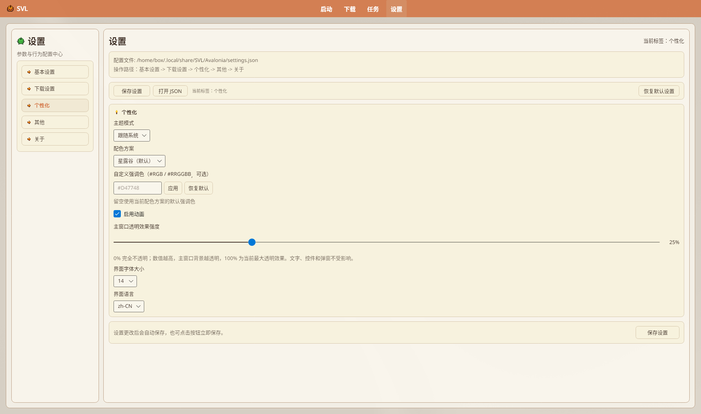

# 主题与外观

在 **「设置」→「个性化」** 调整主题、配色、透明度、字号与界面语言。

源码：`SettingsPageView.axaml` 个性化卡片、`ThemeService`、`AppUserSettings`、`GameCursorService`。

实机可见：主题模式 **跟随系统**、配色 **星露谷（默认）**、强调色示例 `#D47748`、**启用动画**、主窗口透明 **25%**、字号 **14**、语言 **zh-CN**。

## 目录

- [入口](#入口)
- [主题模式](#主题模式)
- [配色方案与强调色](#配色方案与强调色)
- [动画与透明度](#动画与透明度)
- [字号与语言](#字号与语言)
- [游戏风格指针](#游戏风格指针)
- [与旧文差异](#与旧文差异)

## 入口

1. 导航 **「设置」**。  
2. 左侧 **「个性化」**。

多数项会写入 `settings.json` 并尽快生效；调试类选项可能要重启（见「其他」页提示）。

## 主题模式

下拉（`ThemeModes`）：

| 选项 | 说明 |
|------|------|
| **浅色** | 固定浅色 |
| **深色** | 固定深色 |
| **跟随系统** | 跟 Avalonia 平台主题；系统变化时更新 |

默认多为 **跟随系统**。

> 旧文写「仅跟随 Windows」：现为跨平台跟随系统主题。

## 配色方案与强调色

**配色方案**（`ThemeService` 预览色）：

| 显示名 | PreviewColor |
|--------|--------------|
| 星露谷（默认） | `#D47748` |
| 天空蓝 | `#1976D2` |
| 森林绿 | `#388E3C` |
| 薰衣紫 | `#7B1FA2` |
| 海洋青 | `#00796B` |
| 樱花粉 | `#C2185B` |
| 夕阳橙 | `#E64A19` |

**自定义强调色**（标签「自定义强调色（#RGB / #RRGGBB，可选）」）：

1. 填 `#RGB` / `#RRGGBB`（水印示例 `#D47748`；可省略 `#`，三位会扩成六位）。  
2. **「应用」**。  
3. **「恢复默认」** 清空并恢复当前方案默认色。  

状态行：`PrimaryColorStatus` 默认「留空使用当前配色方案的默认强调色」；有效色「当前强调色：#RRGGBB」；非法「颜色格式应为 #RGB 或 #RRGGBB」/「无法解析颜色：…」。状态栏：`自定义强调色已应用（正在自动保存）`（输入即时）或 `（已自动保存）`（点应用）。空强调色时跟随当前配色方案。暗色模式下 `ThemeService.ReapplyThemeAccent` 会把强调色向白色混合约 **25%** 提亮，便于可读。

配色方案在源码里多为 **MaterialYou** 色板变体 + 独立的「星露谷（默认）」；界面下拉显示短名（天空蓝等），写入 `ThemeStyleName` / 方案枚举。

## 动画与透明度

| 界面文案 | 说明 |
|----------|------|
| **启用动画** | `EnableAnimations`（本地化键 `Settings.Animation`） |
| **主窗口透明效果强度** | 0–100 滑条（`BackgroundTransparencyPercent`，默认 25）；>0 时 `EnableTransparency` 视为开 |
| 说明文案 | 「0% 完全不透明；数值越高，主窗口背景越透明，100% 为当前最大透明效果。文字、控件和弹窗不受影响。」（`Settings.Transparency.Description`；OCR 偶见「透明。」句号断句，以 Localization 逗号版为准） |

实际透明效果依赖窗口合成 / 系统是否允许；Linux 合成器差异大时可能不明显——以实机为准。

## 字号与语言

- **界面字体大小**：可选 `12 / 13 / 14 / 15 / 16 / 18 / 20`（默认 14）；状态「{字号标签}切换为：n（已自动保存）」。  
- **界面语言**：`zh-CN`、`en-US`；状态「界面语言切换为：{码}（已自动保存）」。  

语言切换后部分导航文案经 `LocalizationService` 刷新。

## 游戏风格指针

启动时 `App.axaml.cs` 调用 `GameCursorService.TryInstall`：用星露谷素材替换默认指针（`Assets/Icons/Stardew/Cursor/`），**设置页无开关**。

| 资源键 / 用途 | 素材 |
|---------------|------|
| 窗口 / 弹出层默认 | `Cursor.png`（热点 0,0；缩放 ×2） |
| `Svl.Cursor.Hand`（按钮、勾选、列表项、菜单等） | `Cursor_Hand.png` |
| `Svl.Cursor.Search` | `Cursor_Info.png` |
| `Svl.Cursor.Add` | `Cursor_Add.png` |
| `Svl.Cursor.Favorite` | `Cursor_Heart.png` |
| `Svl.Cursor.Text` | 系统 I-beam（文本框） |

素材加载失败时回退系统手形，不阻断启动。文本输入与窗口边缘等系统专用指针仍保留。

## 与旧文差异

| 旧表述 | 现况 |
|--------|------|
| 独立「界面布局」拖拽定制 | 个性化页 **无** 布局拖拽编辑器 |
| yaml 里改强调色 | **settings.json** + 设置页 |
| 仅 Windows 亚克力长文 | 跨平台；能力因 OS 而异，勿承诺单一特效名 |

---

## 相关文档

- [设置与配置](./Settings)
