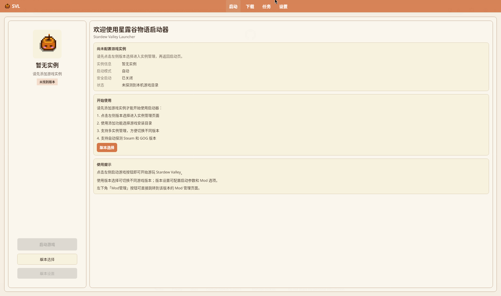
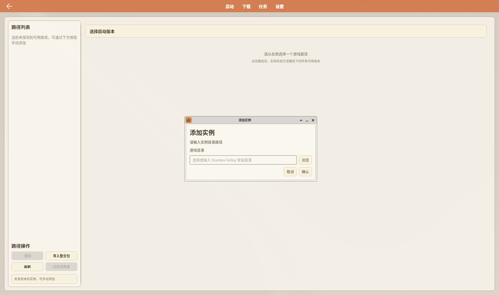
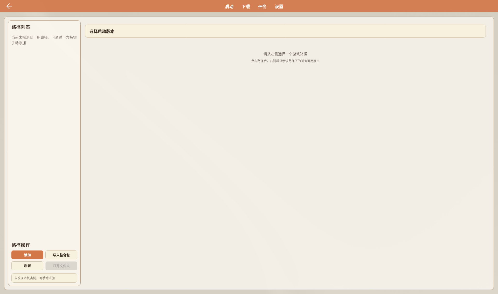
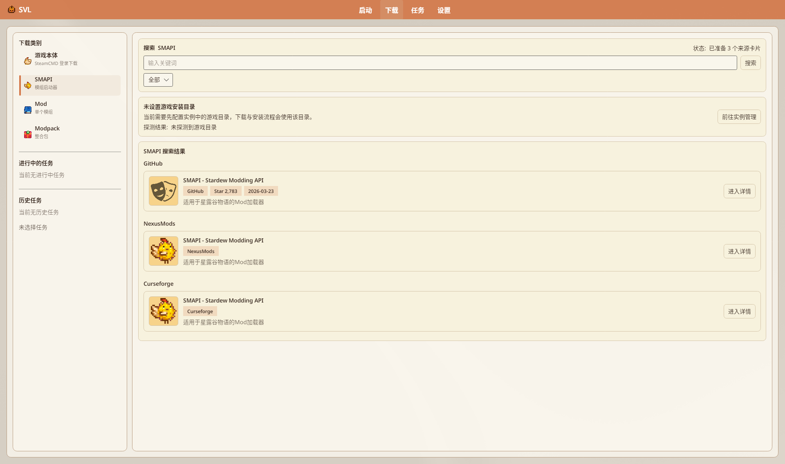
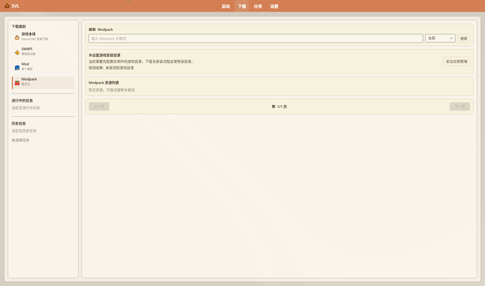

# 创建游戏实例

说明如何添加 Base、用 SMAPI/整合包生成 **versions** 隔离实例，以及进入版本设置。

界面文案以 Avalonia 本地化与 axaml 为准。

## 目录

- [概念](#概念)
- [添加 Base（版本选择）](#添加-base版本选择)
- [方法一：安装 SMAPI 创建实例](#方法一安装-smapi-创建实例)
- [方法二：导入整合包](#方法二导入整合包)
- [方法三：下载页安装整合包](#方法三下载页安装整合包)
- [已有实例上安装 / 更改 SMAPI](#已有实例上安装--更改-smapi)
- [版本设置里能做什么](#版本设置里能做什么)
- [删除实例](#删除实例)
- [常见问题](#常见问题)

## 概念

| 名词 | 含义 |
|------|------|
| **Base** | 传统安装的游戏目录（Steam/GOG 等） |
| **Versions / 隔离实例** | `Base/versions/<名称>/`，独立 Mods 与运行时 |
| **存档** | **各实例共享**系统默认存档；详见 [版本隔离](../features/Version-Isolation) |

> **没有「启用版本隔离」开关**（CHANGELOG 1.1.8.2）。装 SMAPI / 整合包时默认写入 `versions`。

## 添加 Base（版本选择）

1. 启动页点 **「版本选择」**（`Launch.VersionSelect`）。
2. 左侧为路径列表；右侧为该路径下的 **Base** 与 **Versions** 卡片。
3. **路径操作**：
   - **「添加」** — 手动选游戏文件夹
   - **「导入整合包」**
   - **「刷新」** / **「打开文件夹」**
4. 路径右键：**重命名** / **打开文件夹** / **刷新信息** / **删除**（对话框：「确认从列表中移除路径…该操作不会删除游戏文件。」）

首次启动也会探测常见安装路径（`GameInstallPathLocator`）。

## 方法一：安装 SMAPI 创建实例

适合：从 Base **新建**隔离 SMAPI 实例。

### 来源对比

| 来源 | 登录 | 备注 |
|------|------|------|
| GitHub | 否 | 版本较全；网速看地区 |
| CurseForge | 是 | 可能更快；版本列表可能不全 |
| NexusMods | 是 | 自动下载可能需 Premium（以平台规则为准） |

### 步骤（下载页）

1. 导航 **「下载」**。
2. 打开 SMAPI 相关条目/详情（旧图 `SMAPI.png` / `SMAPIList.png`）。
3. 选兼容游戏版本的 SMAPI → **「安装」**。
4. 选择 **Base 路径**（对话框只列 Base，过滤隔离子目录）→ 确认。
5. 输入 **实例名称**（将作为 `versions/<名称>` 文件夹名）→ 确认。
6. 在 **「任务」** 页看进度。

也可把官方 SMAPI zip **拖入窗口**，再走命名与路径确认。

> 在 Base 上执行安装时，流程会 **创建新隔离实例**；已在隔离目录上则多为 **更新当前实例运行时**（见源码注释，与旧 `IsUpdateMode` 对齐）。

## 方法二：导入整合包

1. **版本选择** → **「导入整合包」**；或把包拖入窗口。
2. 选择 Base、填写实例名。
3. 等待解压、装 Mods、装指定 SMAPI。

### 格式（以产品为准）

| 格式 | 备注 |
|------|------|
| `.zip` | 常见；含清单的通用包 |
| CurseForge 导出 | 如 `.cfmodpack` 等（**待核实**现版筛选扩展名） |
| SVL 导出包 | 清单为主、不一定含 Mod 本体（见导出页说明） |

旧图：`drop.png`、`import.png`、`input2.png`。

## 方法三：下载页安装整合包

1. **「下载」** → 整合包分类/搜索（需配置 CurseForge / Nexus 时部分源才完整）。
2. 打开详情 → **「安装」** → 确认 Base 与实例名。

旧图：`modpacklist.png`、`modpackdetail.png`。

## 已有实例上安装 / 更改 SMAPI

1. **版本选择** → 点实例旁齿轮（工具提示 **「版本设置」**）；或启动页 **「版本设置」**。
2. 左侧进 **「自动安装」**。
3. 点 **「安装 / 更改 SMAPI」**（`VersionSettings.AutoInstall.ChangeSmapi`）。
4. 选版本并安装；进度区可能显示「正在安装 SMAPI...」。

原版 Base 概览会提示：可到自动安装页执行 SMAPI 安装/切换。

## 版本设置里能做什么

左侧导航（`VersionSettingsPageView`）：

| 导航 | 作用 |
|------|------|
| **概览** | 名称/描述/图标/收藏；打开实例/存档/Mods 文件夹；删除当前版本或卸载 Base SMAPI |
| **自动安装** | 安装/更改 SMAPI |
| **Mod 管理** | 列表、启用禁用、更新/冲突/汉化检测等 |
| **设置** | 窗口标题、启动参数、Steam 大厅、Steam 启动参数覆写（**无隔离开关**） |
| **导出** | 导出清单类整合包（默认不含 Mod 本体） |

## 删除实例

1. 打开该隔离实例的版本设置 → **概览**。
2. **「删除当前版本」** → 确认。
3. Base **不能**用此按钮删除；Base 上可 **卸载 SMAPI**。

删除内容：该版本目录（含 Mods 等）。**Base 游戏文件保留。存档在系统目录，不会随版本目录删除——仍建议先备份。**

## 常见问题

### SMAPI 安装失败

- 核对选的是 **Base** 且核心文件校验通过（不再死盯某一个 `.exe` 文件名）。
- 查网络 / 代理（设置 → 下载设置）。
- Linux/macOS：符号链接与权限；失败时看任务错误信息。
- 可改用本地 SMAPI zip 拖入。

### 版本兼容

- SMAPI 需匹配游戏版本。
- 部分 Mod 锁定 SMAPI 小版本。

### 多 SMAPI 版本

- 每个 `versions/<名>` 可有自己的 SMAPI。
- Base 与隔离实例不要混用同一 Mods 文件夹。

---

## 相关文档

- [版本隔离](../features/Version-Isolation)
- [游戏实例管理](../features/Instance-Management)
- [Mod 管理](../features/Mod-Management)
- [Modpack 整合包](../features/Modpack-Support)
