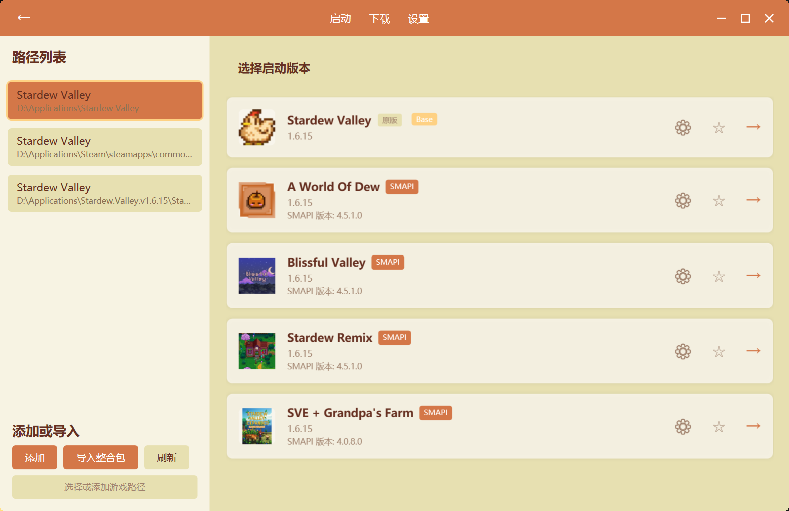
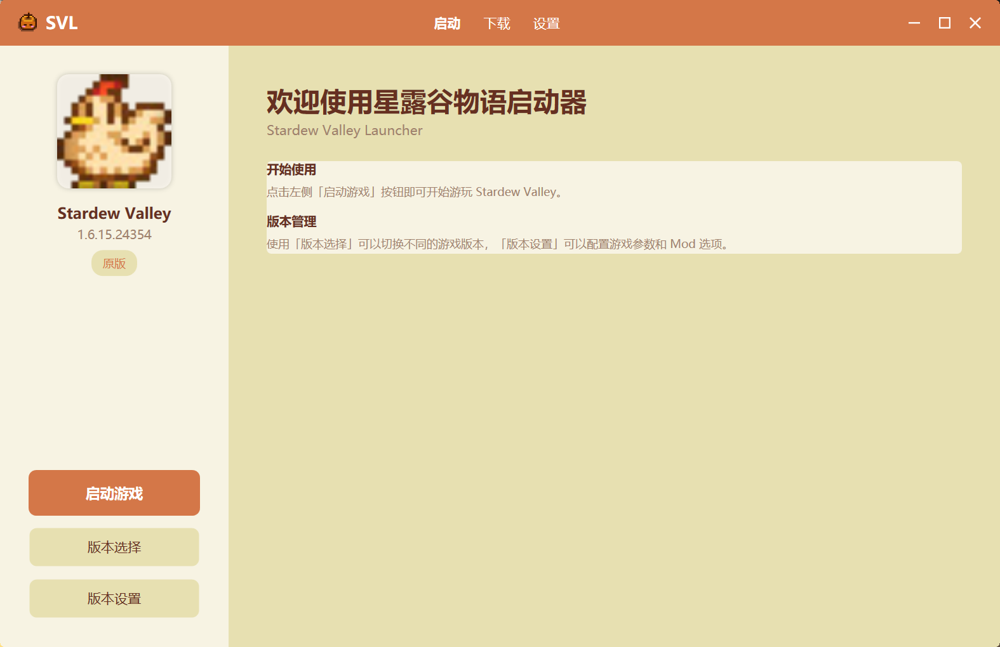
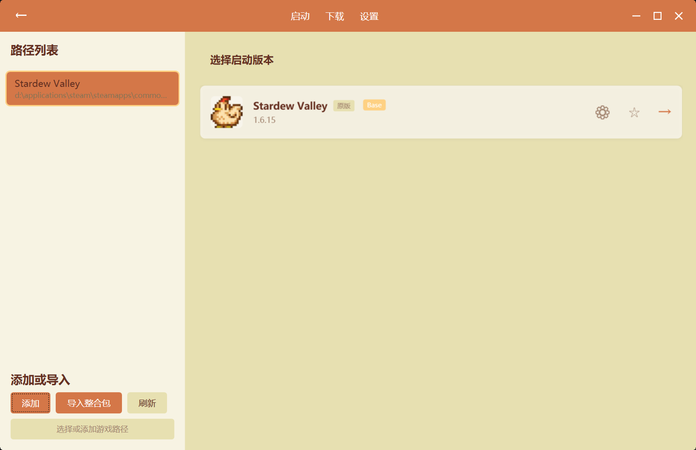
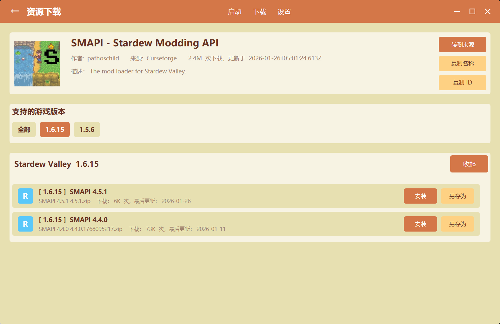
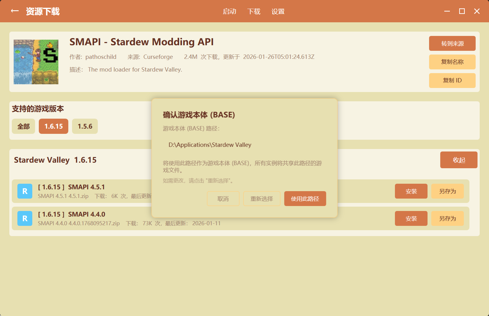
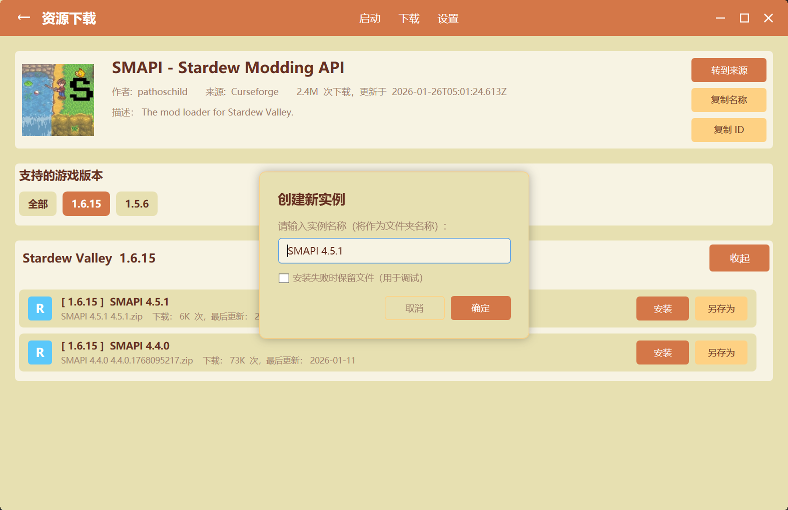
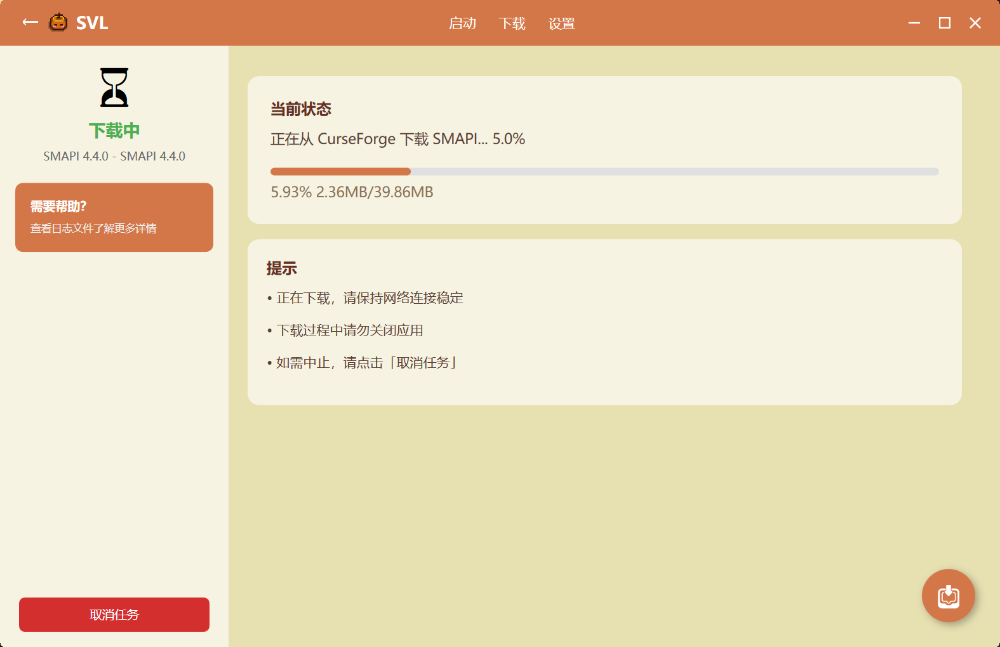
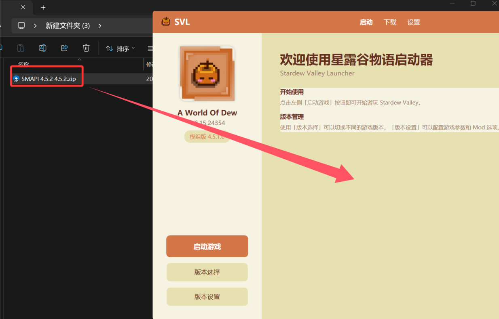
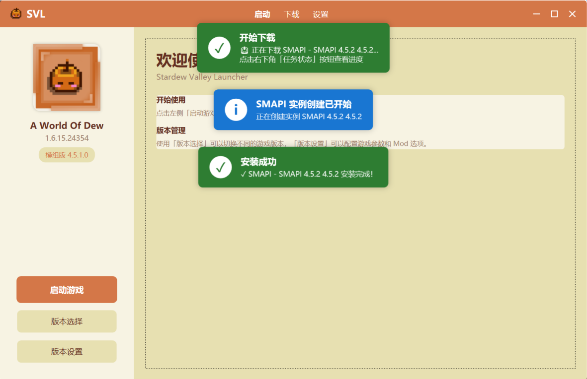
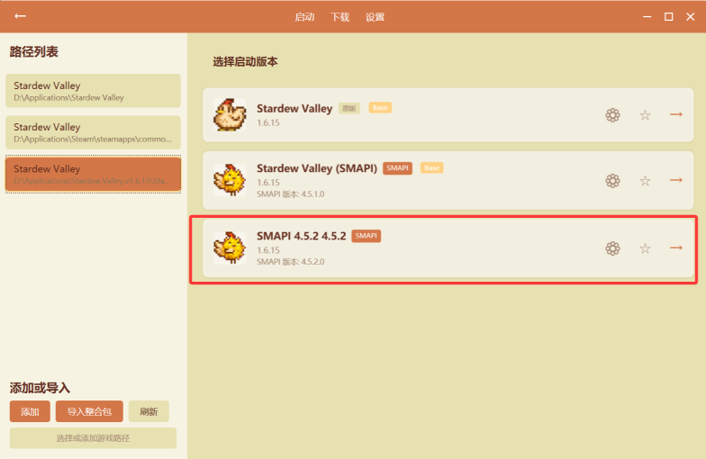

# 初次使用

> 欢迎使用 SVL（Stardew Valley Launcher）！如果你是第一次接触这个启动器，本章节会快速带你：把《星露谷物语》添加为 Base，并创建第一个**版本隔离**的 SMAPI 游戏实例。

> **跨平台提示**  
> 请先按 [安装指南](./Installation) 在 Windows / Linux / macOS 装好 **Avalonia** 版再往下做。  
> 下文流程（Base → 下 SMAPI → 建实例）在各平台一致；**界面按钮原文以你本机为准**。旧截图来自早期版本，若与现版不一致，以现版为准，勿死记截图里的旧文案。  
> 配置目录见安装指南中的 `SVL/Avalonia/` 说明。

## 小科普

**什么是 Base？**

**Base** 指的是通过 **传统的游戏安装方式** 安装的星露谷物语（以及 SMAPI）所在的安装文件夹（例如 Steam 默认的 `...\Steam\steamapps\common\Stardew Valley`；Linux / macOS 上则为对应 Steam/GOG 目录）。

**什么是游戏实例？**

**实例** 是 SVL **最核心的创新**，它让你拥有多个完全独立的游戏环境。

* 拥有自己独立的 **Mods 文件夹** 和 SMAPI 版本。
* 共享同一份游戏本体文件（避免重复占用硬盘空间）。

> 注：版本隔离的实例不同于传统的 Mod 组合，前者对整合包系统适配性更佳。你可以在一个《星露谷物语》下，通过更加系统的管理方式来共存许多整合包。
>
> 这些 Modpacks 使用的都是同一个游戏本体！但是可以随意切换。

## 添加你的 Base 文件夹

启动器进行版本隔离管理的基础是需要一个安装好的《星露谷物语》，它会基于这个作为 Base，然后进行游戏实例的管理与启动。

当你第一次打开 SVL，它会自动检测你现有的 Base 游戏目录（例如 Steam 安装的 Stardew Valley）。探测逻辑覆盖多平台常见路径（见源码 `SVL.Core.Platform/Services/GameInstallPathLocator.cs`）。

如果并没有自动检测到 Base，或者你的游戏安装到其他文件夹的话，可以手动添加到版本列表中：

在主页面进入版本相关入口（界面文案**待核实**是否仍为「版本选择」），然后在版本选择页面按「添加」类按钮选择游戏所在的文件夹就可以了。

（注意：文件夹输入框可以复制路径进去并自动进行解析，可以先在文件管理器找到游戏的位置，然后一键复制游戏路径过去。）

## 创建第一个游戏实例

通过在启动器里 **安装一个新的 SMAPI**（或者直接把 SMAPI 的压缩包拖进去），它就会自动引导你 **创建一个新的游戏实例**。

### 下载 SMAPI

SVL 提供三个源的 SMAPI 自动化安装支持

| 来源 | Github   | Curseforge | NexusMods                           |
| ---- | -------- | ---------- | ----------------------------------- |
| 登录 | 无需登录 | 需要登录   | 需要登录                            |
| 优势 | 版本齐全 | 下载速度快 | 版本齐全                            |
| 劣势 | 网速受限 | 版本不全   | 网速受限，需要 premium 才能自动下载 |

在导航中打开下载相关页面（文案**待核实**是否仍为「下载」），选择对应的源然后打开详情/安装流程。

根据支持的游戏版本在对应的 SMAPI 版本下执行安装。

此时需要确认游戏本体，确认完毕后使用该路径；启动器将会创建使用此文件夹下游戏资源的游戏实例。

输入实例的名称（版本名字）然后确认。

SVL 会自动创建实例并安装 SMAPI；过程中可留意任务/下载进度入口（具体按钮文案**待核实**，旧截图中的「任务管理器」可能已变更）。

### 从本地的 SMAPI ZIP 文件导入安装

选择整合包或 SMAPI 压缩包（`.svlpack`、`.zip` 等），并直接拖入启动器窗口。其余操作同上。

### 检测是否成功安装

提示安装完成后，回到版本/实例列表。

在这里就能发现新的游戏实例。

## 下一步

- [创建游戏实例](./Creating-Instance) - 学习如何创建和管理实例
- [安装 Mod](./Installing-Mods) - 学习如何安装和管理 Mod
- [创建整合包](../features/Modpack-Support)
