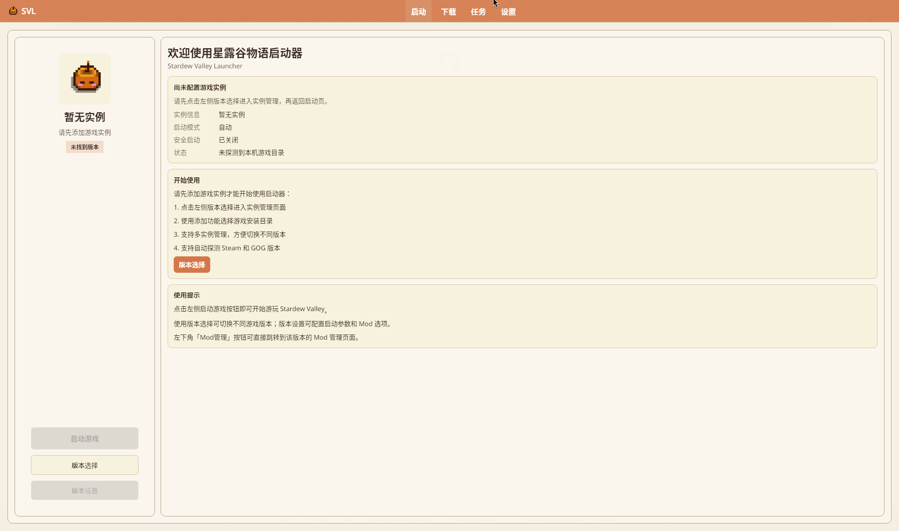
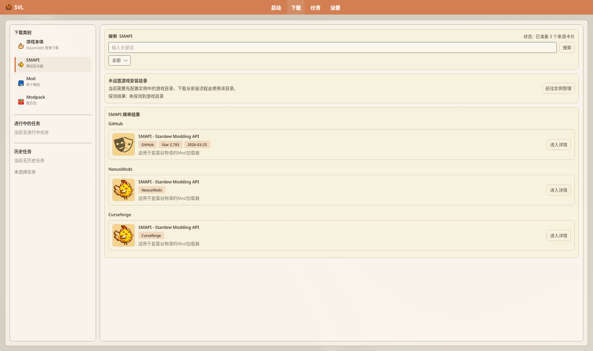

# 安装 Mod

如何把 Mod 装进当前（或指定）游戏实例。界面以 Avalonia 为准。

## 目录

- [前置条件](#前置条件)
- [Mod 来源](#mod-来源)
- [从 NexusMods / CurseForge](#从-nexusmods--curseforge)
- [拖放与本地安装](#拖放与本地安装)
- [启用 / 禁用](#启用--禁用)
- [更新](#更新)
- [注意事项](#注意事项)

## 前置条件

1. 已添加 **Base**，并有带 SMAPI 的实例（见 [创建游戏实例](./Creating-Instance)）。
2. 启动页选中要玩的实例。
3. 需要 Nexus 自动下载时： **设置 → 下载设置 → NexusMods 账户** 登录（不是旧文「设置 → NexusMods」独立顶栏）。

## Mod 来源

| 来源 | 说明 |
|------|------|
| NexusMods | 搜索 / NXM 协议 |
| CurseForge | 搜索 / 整合包 |
| 本地 zip / 文件夹 | 拖放、Mod 管理「+」、或打开 Mods 文件夹手拷 |
| 整合包 | 一次装一整套（见 Modpack 文档） |

## 从 NexusMods / CurseForge

1. 导航 **「下载」**，进入 Mod 搜索（或从下载类别进入）。
2. 搜索并打开详情，选文件版本。
3. 安装/下载；按提示确认目标实例。
4. 进度在 **「任务」** 页查看。

浏览器 Mod 页若唤起 `nxm://`：需已注册 NXM（设置 → 下载设置中的 NXM 卡片），且已登录。

旧步骤写「实例设置 → 自动安装里搜 Mod」：**自动安装页仅 SMAPI 安装/更改**（axaml 无 Mod 搜索）；搜 Mod 请用导航 **「下载」**。

## 拖放与本地安装

1. **拖放**：把 Mod zip 拖到启动器窗口 → 按提示选实例。  
2. **版本设置 → Mod 管理**：
   - **打开文件夹** 后手动放入，再 **刷新**
   - 工具栏 **+**（「从本地安装 Mod」）

## 启用 / 禁用

1. **版本设置 → Mod 管理**  
2. 用行内操作或底栏 **启用已选** / **禁用已选**  
3. 筛选可只看启用/禁用

详情见 [Mod 管理](../features/Mod-Management)。

## 更新

1. Mod 管理 → **检测更新**  
2. 需要时 **批量更新**（入下载队列；确认框会说明备份策略）  
3. 无在线来源的 Mod 需手动换文件

## 注意事项

- Mod 必须进 **当前实例** 的 `Mods`，不要只拷到 Base 却启动另一个 Versions。  
- 存档共享：换实例可能加载同一档；Mod 差异可能导致档不兼容。  
- 导出整合包默认 **不含 Mod 本体**，只有清单/可选配置。

---

## 相关文档

- [Mod 管理](../features/Mod-Management)
- [NexusMods 集成](../features/NexusMods-Integration)
- [版本隔离](../features/Version-Isolation)
